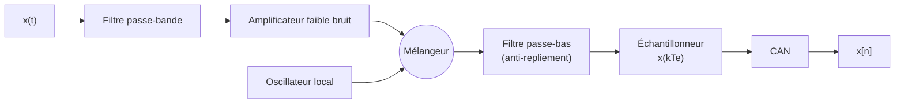

# Les étapes de la numérisation
Retour : [[00 - Sommaire TSN]] · Précédent : [[05 - Densité spectrale de puissance]] · TD associé : [[TD1 - Numérisation]] · Suite : [[07 - Échantillonnage et théorème de Shannon-Nyquist]]

## Modèle de récepteur (homodyne)

> [!tip] Dans ce cours, on s'intéresse à la **sortie du récepteur** $x[n]$.

## Les 3 étapes
1. **Échantillonnage** (en temps)
2. **Quantification** (en amplitude)
3. **Encodage** (→ cours de Télécommunications numériques)

Avant d'échantillonner, on doit aussi **limiter la durée de mesure** $T$ (troncature).

## 0. Troncature : limiter la durée d'observation
On sélectionne un intervalle de durée $T$ avec la fonction indicatrice (porte) :
$$
\Pi_{[-\frac T2;\frac T2]}(t) = \begin{cases}1, & t\in[-\frac T2;\frac T2]\\ 0, & \text{sinon}\end{cases} \qquad\Rightarrow\qquad s(t)\,\Pi_{[-\frac T2;\frac T2]}(t)
$$
Effet spectral → [[08 - Résolution spectrale et fenêtrage]].

## 1. Échantillonnage (idéal)
- **Un échantillon** : $x(t)\,\delta_{t_0}(t) = x(t_0)\,\delta_{t_0}(t)$
- **Échantillonnage à pas constant $T_e$** avec le **peigne de Dirac** $\text{Ш}_{T_e}(t) = \sum_{n\in\mathbb{Z}}\delta_{nT_e}(t)$ :
$$
x(t)\,\text{Ш}_{T_e}(t) = \sum_{n\in\mathbb{Z}} x(nT_e)\,\delta_{nT_e}(t)
$$
- **Sur un intervalle de durée $T$** :
$$
x(t)\,\text{Ш}_{T_e}(t)\,\Pi_{[-\frac T2;\frac T2]}(t) = \sum_{nT_e\in[-\frac T2;\frac T2]} x(nT_e)\,\delta_{nT_e}(t)
$$
- $T_e$ = **période d'échantillonnage**, $F_e = 1/T_e$ = **fréquence d'échantillonnage**.
- Nombre de points : $N = \lfloor T/T_e \rfloor + 1$.

> [!note] Propriété de définition du peigne
> $\displaystyle\int_{\mathbb{R}} x(t)\,\text{Ш}_{T_e}(t)\,dt = \sum_{n\in\mathbb{Z}} x(nT_e)$

Exemple fil rouge du cours : $s(t) = \cos(2\pi f_0 t) + 0.7\cos(2\pi f_1 t)$, $f_0 = 10$ Hz, $f_1 = 25$ Hz, échantillonné à $F_e = 100$ Hz.

Effet spectral → [[07 - Échantillonnage et théorème de Shannon-Nyquist]].

## 2. Quantification
> [!note] Définition
> On fixe $\Gamma = \{\alpha_1, \dots, \alpha_M\}$ un ensemble de **niveaux** et $P_\Gamma$ la fonction qui **projette** son entrée sur la valeur la plus proche dans $\Gamma$ :
> $$P_\Gamma\Big(x\,\text{Ш}_{T_e}\,\Pi_{[-\frac T2;\frac T2]}\Big)(t)$$
> Cette opération se **modélise comme l'ajout d'un signal aléatoire** (bruit de quantification) au signal échantillonné → [[10 - Bruit de numérisation]].

- Quantification **uniforme** sur $n$ bits : $M = 2^n$ niveaux régulièrement espacés d'un **pas** $\Delta$.
- Pour une image : l'image continue est projetée sur une matrice de capteurs (échantillonnage spatial) puis chaque pixel est quantifié (ex. 8 bits = 256 niveaux de gris). Moins de bits → aplats visibles (« postérisation »).

## 3. Encodage
On associe à chaque échantillon un **code de $n$ bits**.

> [!example] 2 bits (4 niveaux), $\Delta = 0{,}9$ V
> | $x_q[n]$ (V) | Code |
> |---|---|
> | 1,35 | 11 |
> | 0,45 | 10 |
> | −0,45 | 01 |
> | −1,35 | 00 |
>
> Flux binaire : `1110010101000001…`

> [!example] 3 bits (8 niveaux), $\Delta = 0{,}45$ V
> | $x_q[n]$ (V) | Code | $x_q[n]$ (V) | Code |
> |---|---|---|---|
> | 1,575 | 111 | −0,225 | 011 |
> | 1,125 | 110 | −0,675 | 010 |
> | 0,675 | 101 | −1,125 | 001 |
> | 0,225 | 100 | −1,575 | 000 |
>
> Flux binaire : `111101011011011…`
>
> **Un bit de plus ⟹ pas divisé par 2** (0,9 → 0,45 V) ⟹ erreur de quantification divisée par 2.

## Modèle complet du signal numérisé
$$
\underbrace{P_\Gamma}_{\text{quantif.}}\Big(s(t)\ \underbrace{\Pi_{[-\frac T2;\frac T2]}(t)}_{\text{durée finie}}\ \underbrace{\text{Ш}_{T_e}(t)}_{\text{échantillonnage}}\Big)
$$
