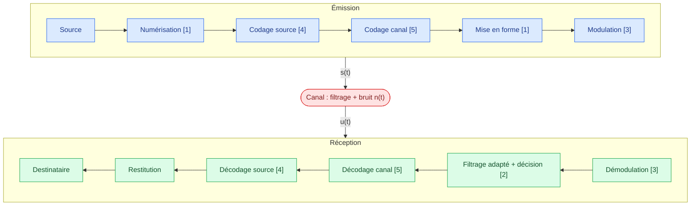

# Télécommunications numériques — Sommaire

> [!abstract] Présentation
> Module de télécommunications numériques (CLEAE2 — NED). On y étudie la chaîne complète de transmission numérique : numérisation, codage en ligne, réception optimale, modulations numériques, codage de source et codage de canal.

## Chapitres

1. [[01 - Numérisation et codage en ligne|Numérisation et codage en ligne]]
2. [[02 - Récepteur optimal|Le récepteur optimal]]
3. [[03 - Modulations numériques|Modulations numériques]]
4. [[04 - Codage de source|Le codage de source]]
5. [[05 - Codage de canal|Le codage de canal]]

## Travaux dirigés

- [[TD1 - Modulations numériques|TD1 — Modulations numériques]]

## Vue d'ensemble de la chaîne de communication numérique

Chaque bloc de l'émission a son « miroir » à la réception ; le numéro du chapitre qui le traite est indiqué entre crochets.

| Chapitre | Question à laquelle il répond |
|---|---|
| 1 | Comment transformer un signal en bits, puis les bits en onde ? |
| 2 | Comment retrouver les symboles malgré le bruit et l'IES ? |
| 3 | Comment placer le signal sur une porteuse adaptée au canal ? |
| 4 | Comment enlever la redondance inutile (compresser) ? |
| 5 | Comment ajouter de la redondance utile pour corriger les erreurs ? |

> [!tip] À retenir
> - **Codage source** : élimine la redondance inutile (compression).
> - **Codage canal** : ajoute de la redondance utile pour détecter/corriger les erreurs.
> - **Codage en ligne / mise en forme** : associe un support physique (onde) aux éléments binaires.
> - **Modulation** : transpose le signal en bande de base vers une fréquence porteuse adaptée au canal.

## Révision
- QCM du module : [/qcm/](/qcm/) (catégorie « TSN-CLEAE2-NED »)
