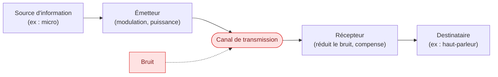
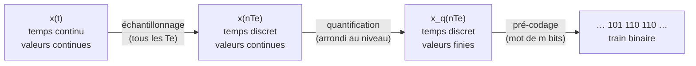
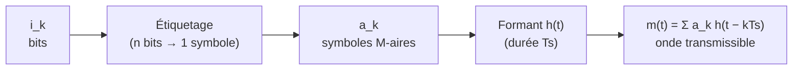
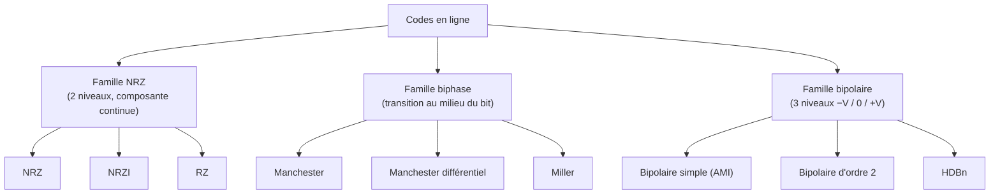
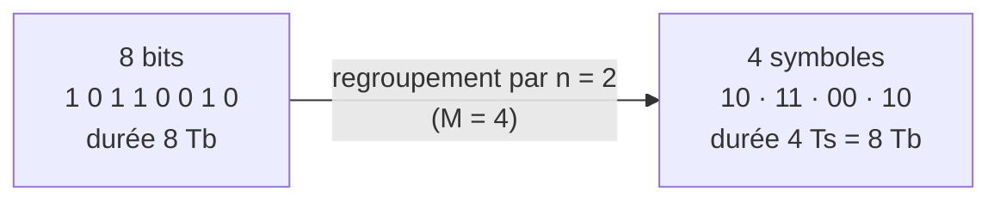

# Numérisation et codage en ligne
Retour : [[00 - Sommaire TSN-CLEAE2-NED]] · Suite : [[02 - Récepteur optimal]]

## Objectifs du cours

- Rappeler les étapes de la numérisation.
- Expliquer l'utilité du codage en ligne.
- Illustrer les raisons du choix d'un type de codage en ligne.

## La chaîne de télécommunications

Une chaîne de télécommunications classique se compose des blocs suivants :

| Bloc | Rôle | Exemple |
|---|---|---|
| Source | Transforme l'information brute en énergie électrique (*transduction*) | Micro |
| Émetteur | Transforme le signal en vue de sa transmission (modulation) et de son émission (puissance) | AM, FM |
| Canal | Transfère à distance le signal contenant l'information | Paires torsadées, fibres optiques, guide d'onde, faisceau hertzien |
| Récepteur | Traite le signal reçu pour réduire les perturbations (bruit) et compenser l'affaiblissement induit par le canal | Idéalement $\hat{m}(t) = m(t)$ |
| Destinataire | Réalise la transduction de réception pour retrouver la nature originale du message | Haut-parleur |

### Chaîne de communication numérique détaillée

Les couleurs indiquent dans quel « monde » se trouve l'information : **analogique** (orange), **numérique** (bleu), ou les deux selon la source (gris).

```mermaid
flowchart LR
    subgraph EM["Émission"]
        direction LR
        S["Source"] --> N["Numérisation"] --> CS["Codage source"] --> CC["Codage canal"] --> MF["Mise en forme"] --> MOD["Modulation /<br/>émission BdB"]
    end
    CAN(["Canal<br/>+ bruit n(t)"])
    subgraph RE["Réception"]
        direction RL
        DEM["Démodulation /<br/>réception BdB"] --> DEC["Décision"] --> DCC["Décodage canal"] --> DCS["Décodage source"] --> RES["Restitution"] --> D["Destinataire"]
    end
    EM -->|"s(t)"| CAN
    CAN -->|"u(t)"| RE
    classDef ana fill:#ffedd5,stroke:#ea580c,color:#7c2d12
    classDef num fill:#dbeafe,stroke:#2563eb,color:#1e3a8a
    classDef mix fill:#f3f4f6,stroke:#6b7280,color:#111827
    class S,D mix
    class N,CS,CC,DEC,DCC,DCS,RES num
    class MF,MOD,DEM,CAN ana
```

On parle de communication en **« bande de base » (BdB)** lorsque le signal est émis directement, sans transposition en fréquence.

## Vocabulaire de base

- **Source analogique** : délivre une information analogique (ex : micro).
- **Source numérique** : délivre une information sous forme de symboles issus d'un alphabet fini (ex : caméra numérique).
- **Message numérique** : suite de symboles, continu ou discret.
- **Numérisation** : passage d'une représentation analogique de l'information à une représentation numérique.
- **Codage** : convention d'association entre symboles et/ou groupes de symboles d'alphabets différents ou non.
- **Mise en forme** : association entre un symbole et une onde physique.
- **Décision** : attribution d'une valeur d'un signal physique à un symbole.
- **Restitution** : passage d'une représentation numérique de l'information à une représentation analogique.

## Numérique vs analogique

| Avantages du numérique | Inconvénients du numérique |
|---|---|
| Meilleure résistance au bruit | Bande passante plus large |
| Compression de l'information possible | Délai dû au codage/décodage et aux autres traitements numériques |
| Chiffrement facilité | Consommation si puissance de calcul importante |
| Filtrage facilité | |
| Régénération parfaite du signal | |

## Les 3 étapes de la numérisation

> [!info] Buts
> Exprimer par une logique codée une même information (signification identique ou très similaire). Il en résulte une **perte d'information inhérente** au processus de numérisation.

1. **Échantillonnage** : transforme un signal en une suite de valeurs.
2. **Quantification** : représentation des valeurs du signal dans un ensemble fini.
3. **Pré-codage** : transformation des valeurs dans le format désiré pour de futurs traitements numériques.

Les trois étapes sur un même signal (quantification sur 3 bits, soit 8 niveaux) :

![[ned-numerisation-etapes.svg]]

### Échantillonnage

L'échantillonnage consiste à discrétiser un signal à temps continu (analogique) en prélevant une suite de valeurs aux instants $t_n = nT_e$ ($n$ entier relatif).

$$F_e = \frac{1}{T_e} \quad \text{(fréquence d'échantillonnage)}$$

> [!tip] Théorème de Nyquist-Shannon
> Pour pouvoir reconstruire parfaitement un signal échantillonné, il faut que $F_e$ soit supérieure ou égale à deux fois la fréquence maximale $f_{max}$ de ce signal :
> $$F_e \geq 2 \times f_{max}$$

- L'opération d'échantillonnage en temps a pour effet, en fréquence, de **périodiser le spectre** du signal à la période $F_e$.
- Si la condition du théorème n'est pas vérifiée, il y a **repliement de spectre** (*aliasing*) et donc perte d'information (mélange d'information autour de $F_e/2$).
- Un signal d'énergie finie ne peut être à la fois de durée finie et à bande limitée : un **filtrage anti-repliement (anti-aliasing)** est donc obligatoire avant échantillonnage.

![[ned-repliement-spectre.svg]]

*En haut, les copies du spectre (décalées de Fe) restent séparées : un filtre passe-bas de coupure Fe/2 récupère le spectre d'origine. En bas, elles se recouvrent : les fréquences « se replient » autour de Fe/2 et ne peuvent plus être séparées.*

> [!example]- Exercice : fréquence d'échantillonnage d'un CD audio
> La bande passante de l'oreille est comprise entre 20 Hz et 20 kHz environ ⇒ on filtre tout ce qui dépasse 20 kHz. $f_{max}$ = 20 kHz, donc $F_e$ doit être au moins égale à 40 kHz. Le standard choisi est **$F_e$ = 44,1 kHz**.
>
> Autres standards :
> - CD : 44,1 kHz sur 16 bits
> - DVD/SACD : de 96 kHz à 192 kHz sur 16 ou 24 bits
> - Enregistreurs numériques pro/grand public (DAT, Minidisc) : 48 kHz sur 16 bits

### Quantification

La quantification a pour but de représenter les valeurs du signal dans un **ensemble fini de valeurs** : les valeurs échantillonnées sont « arrondies » à la graduation la plus proche.

> [!warning] Erreur/bruit de quantification
> C'est la différence entre la valeur échantillonnée et sa valeur quantifiée. C'est un phénomène **inhérent** au processus de quantification.

- **Quantification uniforme** : la taille des intervalles de quantification est constante (le *pas de quantification*). Le bruit de quantification diminue quand le pas diminue.
- **Quantification non uniforme** : la taille des intervalles est variable (ex : numérisation de la parole).

### Pré-codage

Le pré-codage consiste à définir des symboles (en général binaires) pour désigner chaque niveau de quantification.

- **Pré-codage binaire** : mots de $m$ bits correspondant à $M = 2^m$ niveaux de quantification.
  - $m$ : le **moment**, nombre de bits de codage de l'information = nombre de bit pour code l'information.
  - $M$ : la **valence**, nombre total d'états possibles = Taille de l'alphabet

> [!question]- Exercice : que vaut $m$ pour $M=4$ ? $M=16$ ? $M=9$ ? Que vaut $M$ si $m=5$ ? Si $m=6$ ?
> - $M=4 \Rightarrow m=2$
> - $M=16 \Rightarrow m=4$
> - $M=9 \Rightarrow m=4$ (avec des combinaisons inutilisées, car $2^3 < 9 \leq 2^4$)
> - $m=5 \Rightarrow M=32$
> - $m=6 \Rightarrow M=64$

### Notion de symbole

- Un **symbole** est un élément d'un alphabet.
- Si la valence de l'alphabet vaut $M$, le symbole est dit **M-aire** (si $M=2$, il est dit **binaire**).
- On passe d'un alphabet binaire à un alphabet de taille $M > 2$ par regroupement en paquets de $n$ bits : $M = 2^n$.
- Réciproquement, un symbole M-aire véhicule $n = \log_2(M)$ bits.

### Exemple de numérisation : le CD audio

> [!example]- Application
> CD audio : 16 bits pour coder 65 536 niveaux de quantification, $F_e$ = 44,1 kHz, signal stéréo (on double les données).
>
> - Débit : $D = 2 \times 16 \times 44100 = 1{,}41$ Mbit/s
> - Capacité pour 70 min : $C = D \times 70 \times 60 / 8 = 741$ Mo

## Le codage en ligne

### Définitions et principe

**Objectif** : établir un lien entre les symboles logiques $i_k$ obtenus durant la phase de numérisation (mots binaires issus du pré-codage, de longueur $n$ en général) et des ondes physiques transmissibles sur un support.

> [!tip] À retenir
> Le **codage en ligne** est une convention d'association (bijection) entre symboles logiques et formes d'ondes.

Deux possibilités :
- **Émission en bande de base** : modulation en bande de base = codage en ligne.
- **Émission sur fréquence porteuse appropriée** (disponibilité de bande, adaptation au support…) : modulation sur fréquence porteuse (voir [[03 - Modulations numériques]]).

### Étiquetage et mise en forme

- $i_k$ : suite binaire d'information issue du pré-codage, d'un codage de source/canal, ou directement d'une source numérique.
- $a_k$ : regroupement des $i_k$ en mots binaires de longueur $n$ (symboles), appartenant à un alphabet de taille $M = 2^n$.
- $h(t)$ : le **formant** utilisé, $T_s$ le temps symbole.

**Exemple** : alphabet $A = \{-1, +1\}$, étiquetage bipolaire :
- $i_k = 0 \Rightarrow a_k = -1$
- $i_k = 1 \Rightarrow a_k = +1$

Le message est alors : $m(t) = \sum_k a_k \, h(t - kT_s)$

### Principaux formants

| Formant | Description |
|---|---|
| **NRZ** (Non Return to Zero) | Le signal occupe toute la durée $T_s$ du symbole |
| **RZ** (Return to Zero) | Le signal revient à 0 après une demi-période $T_s/2$ |
| **Biphase** (Manchester) | Transition au milieu du temps symbole |

### Exemples de codage en ligne

#### Codage Manchester (biphase)

- '0' : transition du niveau bas vers le niveau haut.
- '1' : transition du niveau haut vers le niveau bas.
- Étiquetage bipolaire : $n=1$ bit/symbole, $M=2$.
- Utilisé en protocole **Ethernet 10BASE-X** (10BASE5, 10BASE2, 10BASE-T, 10BASE-FL).

#### Codage NRZ (M=4)

Étiquetage par 2 bits soit $M=4$ symboles possibles :

| $(i_k, i_{k+1})$ | $a_k$ |
|---|---|
| (0,0) | $-3\alpha$ |
| (0,1) | $-\alpha$ |
| (1,1) | $+\alpha$ |
| (1,0) | $+3\alpha$ |

### Familles de codes en ligne

**Famille NRZ**
- Code « tout ou rien » avec une composante continue non négligeable ; transcription des bits 0/1 en tension positive/négative.
- **NRZ** : n'utilise pas le 0 ; pas adapté aux signaux constants (perte de synchronisation).
- **NRZI** (inverted) : code utilisant $\pm V$ pendant la durée d'un bit ; on change de polarité au changement lorsqu'il y a un 0, pas de changement pour 0→1 ou 1→1.
- **RZ** : le temps bit est divisé en deux, le signal prend la valeur 0 pendant la moitié du temps.

**Famille biphase**
- Séparation du temps bit en deux ; chaque bit prend la valeur $+V/-V$ ou $-V/+V$.
- **Biphase (Manchester 1)** : règle fixe ($-V \to +V$ si 1, $+V \to -V$ si 0, ou l'inverse).
- **Biphase différentiel (Manchester 2 / DME)** : code la différence entre deux bits (pas de changement de transition si 0, changement si 1).
- **Codage de Miller (Delay Mode)** : changement d'état au milieu du temps bit si 1 ; pas de changement au milieu du 1er 0 mais changement à la fin si le bit suivant est un 0. Pas de transition = 0, transition = 1. DSP plus étroite que Manchester, débit plus élevé.

**Famille bipolaire**
- 3 niveaux : $-V/0/+V$. Appelé aussi **code AMI** (Alternate Mark Inversion), pour des transmissions rapides sur longue distance.
- **Bipolaire simple** : 0 quand bit 0 ; alternativement $+V/-V$ quand bit 1.
- **Bipolaire d'ordre 2** : les bits sont regroupés par suite identique (un 1 codé $+V/-V$ selon la dernière impulsion, une suite de deux 1 codée $+V\,-V$ ou $-V\,+V$, une suite de trois 1 codée $+V\,+V\,-V$ ou $-V\,-V\,+V$).
- **Bipolaire à haute densité HDBn** : limite le nombre de 0 consécutifs en intégrant des suites de remplissage avec bits de « viol » et de « bourrage ».

La même séquence `01101001` codée avec cinq codes différents :

![[ned-codes-en-ligne.svg]]

> [!example] Ce qu'il faut observer sur la figure
> - **NRZ** : longues plages constantes pour `11` ou `00` → peu de transitions, synchronisation difficile, composante continue.
> - **RZ** : une suite de 0 donne un signal nul → aucune transition pour se synchroniser.
> - **Manchester** : une transition au milieu de *chaque* bit → horloge facile à récupérer, moyenne nulle, mais deux fois plus de transitions (bande plus large).
> - **Miller** : moins de transitions que Manchester → spectre plus étroit.
> - **AMI** : les 1 alternent +V/−V → moyenne nulle, mais une suite de 0 reste sans transition (d'où HDBn).

> [!tip] À retenir
> Pas de puissance à la fréquence nulle pour le codage Manchester (et globalement les codes biphase) : pas de composante continue et peu d'énergie en basses fréquences, car la valeur moyenne du signal est nulle.

### Densité spectrale de puissance (DSP) des principaux codes

| Code | Formant | Largeur de bande (premier lobe) |
|---|---|---|
| NRZ bipolaire | $h(t) = A \cdot \text{rect}_{T_s}(t)$ | $B_{NRZ} = 2/T_S$ |
| RZ unipolaire | $h(t) = A \cdot \text{rect}_{T_s/2}(t)$ | $B_{RZ} = 4/T_S$ |
| Manchester | $h(t) = A \cdot \text{rect}_{T_s/2}(t) - A \cdot \text{rect}_{T_s/2}(t-T_s/2)$ | $B_{Man} = 4/T_S$ |

![[ned-dsp-codes.svg]]

*DSP normalisées : plus le formant est court (RZ, Manchester : impulsions de durée $T_s/2$), plus le spectre est large. Le Manchester n'a aucune puissance en $f = 0$.*

> [!info] Pour aller plus loin
> La formule de Bennett permet de calculer analytiquement la DSP d'un signal codé en ligne à partir de son formant et de la statistique des symboles.

### Choix du codage en ligne

Le choix du codage en ligne détermine les caractéristiques physiques du signal (notamment sa largeur de bande) et doit être adapté au canal de transmission (fibre optique, câble coaxial, atmosphère…) et au matériel utilisé.

C'est un **compromis** entre :
- **Bande passante** : la largeur de bande la plus faible possible.
- **Composition du signal** : présence ou non d'une composante continue.
- **Synchronisation** : récupération de la synchronisation à la sortie du canal (nombre de transitions d'état). Pour détecter correctement les informations, le récepteur doit être synchronisé avec l'émetteur (problème typique : une longue suite de 0 en étiquetage unipolaire/formant RZ ne génère aucune transition, donc pas de synchronisation possible).

### Rapidité de modulation vs débit binaire

- **Rapidité de modulation** d'une source M-aire : $R = \dfrac{1}{T_s}$, en Bauds (Bd) = symboles/s. C'est le nombre de symboles transmis par seconde.
- **Débit binaire** : $D = \dfrac{1}{T_b}$, en bit/s. C'est le nombre de bits transmis par seconde.
- $T_s = n T_b$ car un symbole véhicule $n$ bits, avec $n = \log_2(M)$.
- $R = D/n$ : le débit binaire va $n$ fois plus vite que $R$.

> [!tip] Efficacité spectrale
> $$\eta = \frac{D}{B} \quad \text{(en bits/s/Hz)}$$
> où $B$ est la largeur de bande du signal (formule de Bennett).
>
> On appelle **bande de base** l'intervalle de fréquences comprises entre $f=0$ et une fréquence proportionnelle à $R$.

## Application : signal PCM

> [!question]- Exercice : signal PCM entre 200 Hz et 4 kHz
> Un signal source analogique dont la bande de fréquence varie de 200 Hz à 4 kHz est codé en PCM.
>
> **Fréquence d'échantillonnage minimale (Nyquist) ?**
> $f = 2 \times 4\text{ kHz} = 8$ kHz
>
> **Période T entre deux impulsions ?**
> $T = 1/f = 125\ \mu s$
>
> Le signal varie entre −1 V et +1 V, codé sur 8 bits.
>
> **Pas de quantification ?**
> Intervalle de 2 V, 256 valeurs discrètes soit 255 intervalles : pas $= 2/255 = 7{,}8431$ mV
>
> **Durée de chaque bit et débit binaire à la fréquence de Nyquist ?**
> Durée du bit $= T/8 = 125/8 = 15{,}625\ \mu s$
> Débit binaire $= 1/\text{durée du bit} = 64\,000$ bit/s

## Exercices

> [!question]- Exercice 1 : Codage en ligne et formant RZ
> Système de transmission binaire en bande de base unipolaire : bit 0 → $a_k=0$, bit 1 → $a_k=1$. Symboles indépendants et équiprobables. Filtre de mise en forme : fonction porte de durée $T_s/2$ et d'amplitude 1 (formant RZ).
>
> **Tracer le signal émis pour la séquence binaire 01101.**
> Codage unipolaire (binaire non symétrique) : $i_k=0 \to a_k=0$ et $i_k=1 \to a_k=1$. Le signal prend la valeur 1 pendant la première moitié de $T_s$ pour chaque bit à 1, et 0 sinon.
>
> ![[ned-exo-rz-01101.svg]]

> [!question]- Exercice 2 : Codage en ligne et formant NRZ
> Système de transmission M-aire ($M=2^n$) symétrique en bande de base, débit binaire $D=1/T_b$. Formant NRZ : fonction porte de durée $T_s$ et d'amplitude 1.
>
> **Q1 : Exprimer $T_s$ en fonction de $T_b$.**
> $T_s = n \cdot T_b$
>
> **Q2 : Exprimer l'efficacité spectrale en fonction de $n$.**
> $\eta = D/B$, avec $B \propto 1/T_s$ ; l'efficacité spectrale croît avec $n$ (plus de bits par symbole pour une même bande occupée).
>
> **On souhaite doubler le débit binaire.**
>
> **Q3 : Deux moyens d'y parvenir et leurs conséquences ?**
> - Diviser $T_s$ par deux (augmenter $R$) : la bande passante double, la puissance d'émission doit augmenter pour garder la même probabilité d'erreur.
> - Doubler $n$ (augmenter $M$) : la bande passante reste identique mais les symboles sont plus rapprochés (distance minimale réduite) ⇒ la probabilité d'erreur augmente à puissance égale.
>
> **Q4 : Conclusion générale ?**
> Il existe un compromis fondamental entre débit binaire, bande passante occupée, puissance d'émission et probabilité d'erreur : on ne peut optimiser tous ces paramètres simultanément.

## Entraînement

> [!question]- Questions de cours
> - Détaillez les principales étapes de la numérisation.
> - Quel est l'objectif du codage en ligne ?
> - Expliquez pourquoi le débit binaire est relié à la rapidité de modulation.
> - Quels sont les paramètres à prendre en compte pour choisir un codage en ligne ?
> - Qu'est-ce que l'efficacité spectrale ?
> - Comment définiriez-vous la probabilité d'erreur d'une transmission ?
