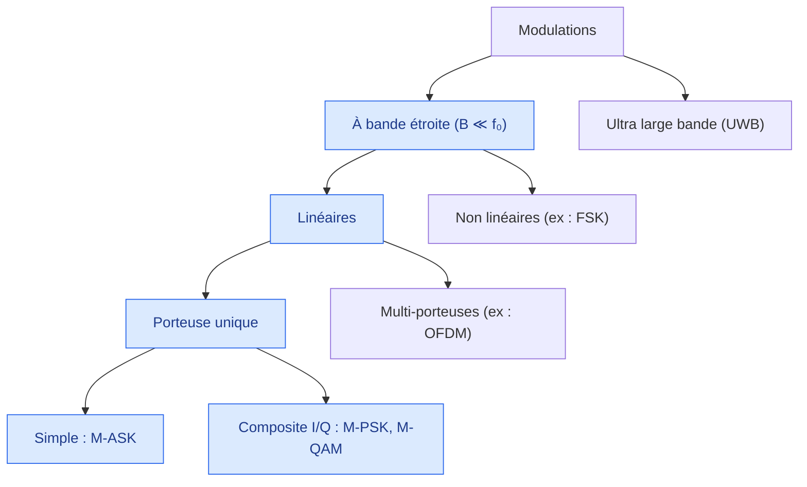
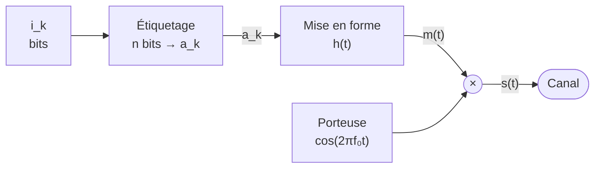
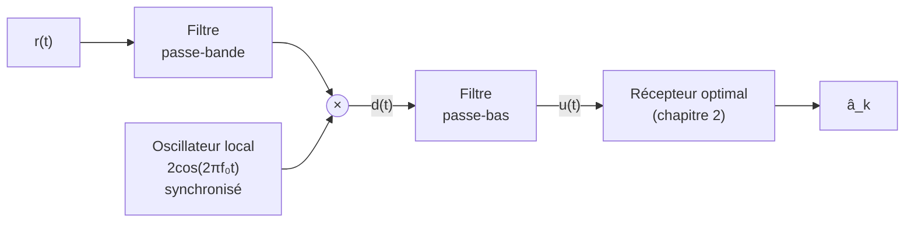
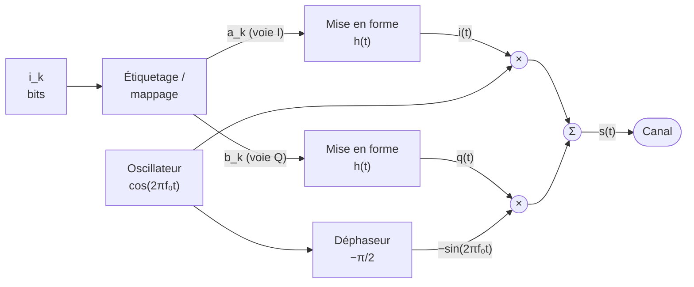
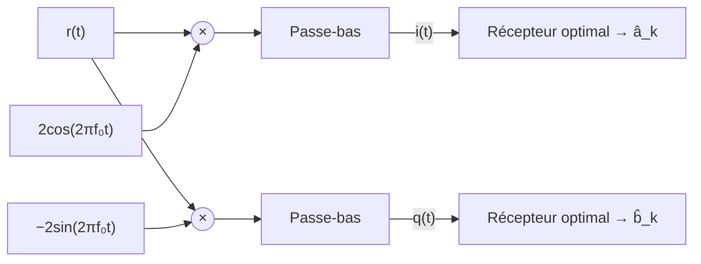

# Modulations numériques
Retour : [[00 - Sommaire TSN-CLEAE2-NED]] · Précédent : [[02 - Récepteur optimal]] · Suite : [[04 - Codage de source]]

## Objectifs du cours

- Donner le principe général d'une modulation et expliquer en quoi cette opération est nécessaire.
- Détailler les modulations numériques linéaires à bande étroite sur porteuse unique (amplitude, phase, quadrature).

Vidéo d'introduction : [Les modulations numériques (25 min)](https://youtu.be/xZr3QEB7jV0)

## Plan

1. Principe et nécessité de la modulation
2. Modulation d'amplitude
3. Modulations en phase et en quadrature

## Transmission bande de base ou sur fréquence porteuse

- **Transmission en bande de base** : transmission directe du signal, le spectre démarre à partir de la fréquence zéro. Nécessite un canal avec une bande passante en basses fréquences. Problèmes : encombrement de certaines bandes, portée réduite, canal non optimisé.
- **Transmission en hautes fréquences** : transposition du signal utile en hautes fréquences avant la propagation de l'onde ⇒ opération de **modulation**.

### Pourquoi ne pas transmettre directement en bande de base ?

| Contrainte | Explication |
|---|---|
| Ressource spectrale limitée | Brouillage des communications si transmission en basses fréquences |
| Adaptation à la bande passante du support | La bande passante des canaux est généralement en hautes fréquences |
| Souplesse pour transmission longue distance | Les répéteurs sont des transformateurs ne laissant pas passer la composante continue ($f=0$) du signal |

### Exemples de fréquences porteuses

| Canal | Fréquence | Bande |
|---|---|---|
| TNT (UHF) | 470-830 MHz | 8 MHz |
| GSM | 900 MHz | quelques MHz |
| WiFi | 1,8 / 2,4 / 5,2 GHz | quelques dizaines de MHz |
| Fibre optique | 230 THz (λ = 1300 nm) | 25 GHz |

## Principe de la modulation

Le but de la modulation est de **transposer le spectre** du signal contenant l'information à transmettre autour d'une fréquence porteuse :

$$p(t) = A_0 \cos(2\pi f_0 t + \varphi_0), \quad f_0 \in \text{canal}$$

Réaliser une modulation consiste à faire varier les caractéristiques (amplitude, fréquence, phase) de la porteuse en fonction du signal utile $m(t)$. L'opération inverse (récupérer $m(t)$ à partir du signal modulé) est la **démodulation**.

> [!info] Rappel mathématique
> $$p(t)\, m(t) = \tfrac{1}{2}\big(\cos(2\pi(f_0+f)t + \varphi_0+\varphi) + \cos(2\pi(f_0-f)t + \varphi_0-\varphi)\big)$$
> Le produit de deux sinusoïdes de fréquences $f_0$ et $f$ transpose le spectre autour de $f_0 \pm f$.

![[ned-transposition-spectre.svg]]

*Multiplier $m(t)$ par la porteuse déplace son spectre de 0 vers $\pm f_0$ : l'information est intacte, elle occupe simplement une autre bande de fréquences (au prix d'une bande doublée, $2B$, pour une modulation d'amplitude simple).*

## Choix d'une modulation

Le choix de la porteuse dépend :
- du support de transmission utilisé (équivalent à un filtre),
- des bandes de fréquences disponibles,
- de la largeur de bande du signal à transmettre.

Il existe plusieurs types de modulations : bande étroite / ultra large bande (UWB), linéaires / non linéaires, porteuse unique / multi-porteuses.

## Modulations analogiques (rappel)

- **Modulation d'amplitude (AM)** : le signal source fait varier l'amplitude de la porteuse (la source est l'enveloppe de la porteuse) → sensible aux perturbations électromagnétiques.
- **Modulation de fréquence (FM)** : le signal source fait varier la fréquence de la porteuse → peu sensible aux perturbations d'amplitude.
- **Modulation de phase** : le signal source fait varier la phase de la porteuse.

## Périmètre du cours

- **Modulation à bande étroite** : $B \ll f_0$, transmission dans la bande de cohérence du canal (bande sur laquelle le module de la fonction de transfert du canal est considéré constant).
- **Modulation linéaire** : modulation d'amplitude et de phase (modulateur/démodulateur « simples »).
- **Modulation sur porteuse unique** : simple (amplitude) ou composite (phase et amplitude en quadrature).

*En bleu : le périmètre de ce cours.*

## Modulation numérique — principe général

Principe similaire à la modulation analogique, mais $m(t)$ ne peut prendre qu'un nombre fini de valeurs dans un alphabet connu :

$$m(t) = \sum_k a_k\, h(t - kT_s)$$

- $a_k$ : symbole émis, prend $M$ valeurs pour une modulation M-aire.
- $T_s$ : période d'émission des symboles.
- $h(t)$ : formant utilisé.

Modulations étudiées (linéaires, à bande étroite) :

| Modulation | Nom | Porteuse |
|---|---|---|
| Amplitude à M états | MDA-M / M-ASK (*Amplitude Shift Keying*) | unique |
| Phase à M états | MDP-M / M-PSK (*Phase Shift Keying*) | unique composite (I/Q) |
| Amplitude en quadrature à M états | MAQ-M / M-QAM (*Quadrature Amplitude Modulation*) | unique composite (I/Q) |

## Modulation d'amplitude numérique (M-ASK)

Étiquetage par regroupement de $n = \log_2(M)$ bits, alphabet à $M$ symboles :

$$A = \{-(M-1)\alpha; -(M-3)\alpha; \dots; -\alpha; \alpha; \dots; (M-1)\alpha\}$$

Schéma du modulateur :

### 2-ASK

- **2-ASK « standard »** : $A = \{-\alpha, \alpha\}$. Peu coûteuse mais sensible aux distorsions et au bruit atmosphérique. Utilisée pour les transmissions sur fibre optique.
- **OOK (On-Off Keying)**, modulation « tout ou rien » : $A = \{0, \alpha\}$. La modulation ASK la plus courante. Utilisée pour le code Morse sur fréquences radio ou les communications optiques.

### 4-ASK (exemple, codage de Gray)

| Entrée $(i_k)$ | Amplitude $(a_k)$ |
|---|---|
| 00 | -3 |
| 01 | -1 |
| 11 | +1 |
| 10 | +3 |

> [!info] Codage de Gray
> Deux amplitudes voisines ne diffèrent que d'**un seul bit** (`01` ↔ `11`). Comme les erreurs de décision se font presque toujours vers un symbole voisin, une erreur symbole ne coûte alors qu'un bit erroné.

Allure des signaux modulés pour la même suite de bits :

![[ned-signaux-modules.svg]]

### Démodulation d'une M-ASK

Le filtre passe-bande élimine le bruit en dehors de la bande du signal. En canal à bruit AWGN et affaiblissement nul :

$$d(t) = r(t) \times 2\cos(2\pi f_0 t) = m(t) + m(t)\cos(4\pi f_0 t) + 2b(t)\cos(2\pi f_0 t)$$

Le filtre passe-bas élimine ensuite la composante en $\cos(4\pi f_0 t)$ pour ne garder que $m(t)$ (bande de base).

![[ned-demodulation-spectres.svg]]

## Modulations en phase et en quadrature (porteuse composite)

Pour transmettre deux signaux simultanément sur la même fréquence sans interférence, on utilise deux porteuses de même fréquence déphasées de $\pi/2$ :

$$p_1(t) = A_0 \cos(2\pi f_0 t + \varphi_0), \qquad p_2(t) = -A_0 \sin(2\pi f_0 t + \varphi_0)$$

On parle de **modulation vectorielle complexe** ou **modulation I/Q** (*In-phase / Quadrature*) : modulation de phase (PSK) et modulation d'amplitude en quadrature (QAM).

### Schéma du modulateur I/Q

$$s(t) = i(t)\cos(2\pi f_0 t + \varphi_0) - q(t)\sin(2\pi f_0 t + \varphi_0)$$

### Représentation complexe

On définit l'**enveloppe complexe** du signal : $\underline{s}(t) = i(t) + j q(t)$, un outil mathématique très utile pour représenter les constellations en bande de base.

$$s(t) = \text{Re}\big(\underline{s}(t)\, e^{j2\pi f_0 t}\big)$$

Si $i(t) = \sum_k a_k h(t-kT_s)$ et $q(t) = \sum_k b_k h(t-kT_s)$ alors $\underline{s}(t) = \sum_k c_k h(t-kT_s)$ avec $c_k = a_k + j b_k$.

Le démodulateur I/Q fait l'opération inverse : grâce à l'orthogonalité de $\cos$ et $\sin$, chaque voie ne récupère que son propre signal (démonstration dans le [[TD1 - Modulations numériques#Exercice 2 : Le système UMTS|TD1, exercice 2]]).

Un **diagramme de constellation** est la représentation dans le plan complexe des différents symboles de l'alphabet utilisé lors de l'étiquetage : $a_k$ symbole M-aire réel, $b_k$ symbole N-aire réel, $c_k = a_k + jb_k$ symbole P-aire complexe avec $P = M \times N$ (en général $M=N$).

### Remarque sur la puissance

Pour un signal modulé $s(t)$ stationnaire, avec $DSP(i(t)) = DSP(q(t))$ :

$$P_{\underline{s}}(t) = P(i(t)) + P(q(t)) = 2\, P_s(t)$$

La puissance de l'enveloppe complexe est **le double** de la puissance du signal modulé.

### M-PSK (modulation de phase)

Le module des $c_k$ est constant pour tout $k$ : dans le diagramme de constellation, les $c_k$ sont situés sur un **cercle** (exemple : codage de Gray pour une 8-PSK).

### M-QAM (modulation d'amplitude en quadrature)

L'information est codée à la fois sur l'amplitude et la phase, avec une répartition homogène des points dans le plan complexe (exemple : la 16-QAM, grille régulière de points).

![[ned-constellations.svg]]

*Étiquettes en code de Gray : deux points voisins ne diffèrent que d'un bit. Pour la 16-QAM, les deux premiers bits donnent la position sur l'axe I, les deux derniers sur l'axe Q.*

## Utilisation pratique

- **M-PSK** : 2-PSK (BPSK), 4-PSK (QPSK), 8 ou 16-PSK ⇒ liens satellite (DVB-S) ; 4-PSK (QPSK) ⇒ UMTS, WiFi 802.11b. La M-PSK autorise l'emploi d'amplificateurs non linéaires car l'amplitude est constante.
- **M-QAM** : fibres optiques (hauts débits) ; 64-QAM ⇒ TNT (DVB-T) (16-QAM en Allemagne).

## Entraînement

> [!question]- Questions de cours
> - Pourquoi est-il nécessaire de moduler le signal ?
> - Comment s'effectue la démodulation au niveau du récepteur ?
> - Représentez un schéma d'une modulation en phase et en quadrature (16-QAM).
> - Représentez un schéma d'une modulation I/Q. À quel endroit dans une chaîne de transmission la situeriez-vous ?

## Comparaison des performances des modulations

### Performances d'une 2-ASK

Sans IES, la valeur échantillonnée correspond à la valeur du symbole envoyé additionnée de bruit :
$$\tilde z(n) = \tilde g(0)\, a_n + \tilde b_n \quad (\tilde g(0)=1 \text{ en général})$$

Décision : si $\tilde z(n) > 0$ alors $a_k = +\alpha$ ; si $\tilde z(n) < 0$ alors $a_k = -\alpha$.

![[ned-decision-2ask.svg]]

*La valeur échantillonnée est $\pm\alpha$ plus un bruit gaussien : il y a erreur quand le bruit fait passer la valeur de l'autre côté du seuil (zones colorées). Ces zones sont exactement l'intégrale calculée ci-dessous.*

**Calcul de la probabilité d'erreur symbole $P_e$** (bruit gaussien, blanc, centré, de variance $N_0$) :

$$P_e = P(\tilde b(n) > \alpha) = \int_{\alpha}^{+\infty} \frac{1}{\sqrt{2\pi N_0}} e^{-t^2/2N_0}\, dt$$

En utilisant la fonction de queue gaussienne $Q(x) = \dfrac{1}{\sqrt{2\pi}}\displaystyle\int_x^{+\infty} e^{-t^2/2}\, dt$ :

$$P_e = Q\left(\sqrt{\frac{\alpha^2}{N_0}}\right)$$

**Paramètre de comparaison $E_b/N_0$** :
- $E_b$ : énergie moyenne nécessaire pour émettre un bit sur la fréquence porteuse.
- $N_0$ : variance du bruit sur le canal.
- Par abus de langage, $E_b/N_0$ est souvent confondu avec le RSB.

Pour la 2-ASK : $E_s^{(bb)} = \alpha^2$ (bande de base), $M=2 \Rightarrow E_b^{(bb)} = E_s^{(bb)}$, et $E_b^{(bm)} = \alpha^2/2$ (bande modulée, car l'énergie en bande de base est double de celle en bande modulée). D'où :

$$P_e = Q\left(\sqrt{\frac{2E_b}{N_0}}\right) \quad \text{(2-ASK)}$$

### Performances d'une M-ASK

$$P_e = 2\,\frac{M-1}{M}\, Q\left(\sqrt{\frac{6\log_2(M)}{M^2-1}\cdot \frac{E_b}{N_0}}\right)$$

> [!example]- Calcul de l'énergie bit pour une 4-ASK
> Symboles $-3\alpha, -\alpha, +\alpha, +3\alpha$ (distance minimale $d_{min}=2\alpha$).
> $E_{-3}=E_{+3}=9\alpha^2$, $E_{-1}=E_{+1}=\alpha^2$
> $E_{moy} = \dfrac{E_{-3}+E_{-1}+E_{+1}+E_{+3}}{4} = 5\alpha^2$
> $E_b^{(bb)} = \dfrac{E_{moy}}{\log_2(4)} = \dfrac{5\alpha^2}{2}$ (en bande de base)

### Comparaison géométrique des constellations

- La **distance du symbole à l'origine** représente son énergie $E_s$.
- La **distance entre symboles** représente la résistance au bruit de la constellation (marge d'immunité).
- La **distance minimale $d_{min}$** (plus petite distance entre deux symboles) témoigne de la qualité de la constellation.

Dans le cas général :
$$P_e = N_{min}\, Q\left(\frac{d_{min}}{2\sqrt{N_0}}\right)$$
où $N_{min}$ est le nombre moyen de points à distance $d_{min}$.

Expressions détaillées :

$$P_{e(MDP)} = 2\, Q\left(\sqrt{2\log_2(M)\sin^2\left(\frac{\pi}{M}\right)\frac{E_b}{N_0}}\right) \quad \text{(M-PSK, } M > 2\text{)}$$

$$P_{e(MAQ)} = 4\left(1-\frac{1}{\sqrt M}\right) Q\left(\sqrt{\frac{3\log_2(M)}{M-1}\cdot \frac{E_b}{N_0}}\right) \quad \text{(M-QAM)}$$

$$P_{e(MDA)} = 2\,\frac{M-1}{M}\, Q\left(\sqrt{\frac{6\log_2(M)}{M^2-1}\cdot \frac{E_b}{N_0}}\right) \quad \text{(M-ASK)}$$

> [!tip] À retenir
> $P_e$ décroît de façon exponentielle avec le RSB : une petite augmentation du RSB entraîne une grande diminution de $P_e$.
>
> On parle aussi de **taux d'erreur binaire (TEB)** : avec un codage de Gray, $\text{TEB} = P_e / \log_2(M)$.

Les trois formules tracées (axe vertical logarithmique) :

![[ned-teb-modulations.svg]]

*Lecture : pour $P_e = 10^{-5}$ (pointillé), la 16-QAM demande environ 14 dB, la 16-PSK environ 18 dB et la 16-ASK environ 23 dB. À droite, chaque doublement de la taille de la QAM (2 bits de plus par symbole) coûte environ 4 à 5 dB.*

### Comparaison des modulations linéaires

- Les M-ASK et M-PSK ont une répartition **non homogène** des points dans le plan complexe ⇒ perte d'efficacité (gaspillage d'énergie) par rapport à une M-QAM.
- Tous les points d'une M-PSK ont la même énergie ⇒ utile si des éléments non linéaires sont présents dans la chaîne.
- La M-ASK est très simple à mettre en œuvre.

> [!tip] Compromis
> - À TEB constant, augmenter $M$ augmente l'efficacité spectrale $\eta$ mais nécessite un RSB plus élevé.
> - À $\eta$ et TEB constants, certaines modulations (M-QAM) nécessitent moins de puissance que d'autres (M-PSK, M-ASK).

## Entraînement

> [!question]- Exercice
> Dans un diagramme représentant le TEB en fonction de $E_b/N_0$, les modulations MDA-16, MDP-32 et MAQ-256 semblent avoir les mêmes performances. À débit binaire constant, est-ce vrai en termes d'efficacité spectrale ?
>
> ![[ned-teb-exercice.svg]]
>
> Non : à TEB comparable, ces modulations véhiculent des nombres de bits par symbole différents ($n=4$ pour MDA-16, $n=5$ pour MDP-32, $n=8$ pour MAQ-256). Pour un même débit binaire, elles n'occupent donc pas la même bande passante : $B = D/\eta = D/n$ (approximativement). La MAQ-256 est bien plus efficace spectralement (bande occupée plus faible) que la MDA-16, à débit et TEB comparables, bien qu'exigeant un RSB plus élevé en absolu.
