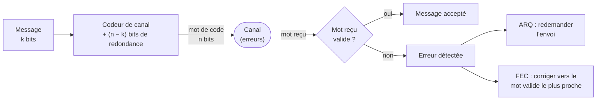
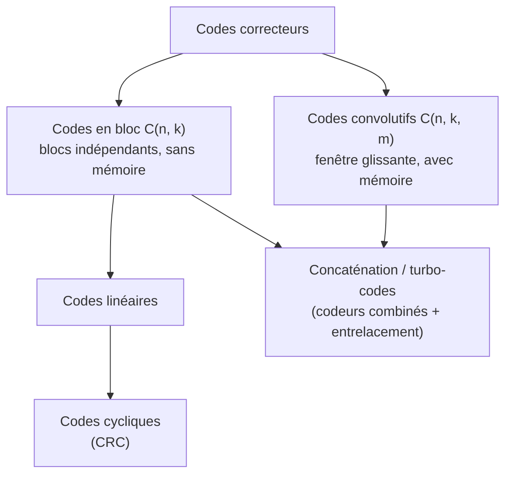
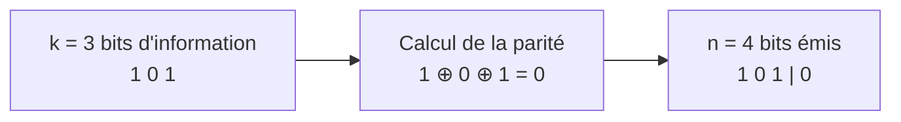
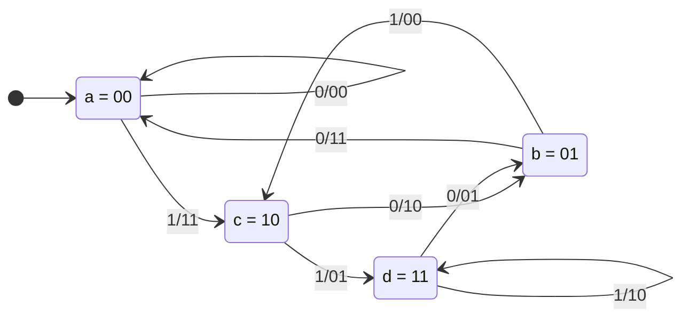
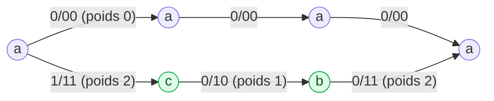

# Le codage de canal
Retour : [[00 - Sommaire TSN-CLEAE2-NED]] · Précédent : [[04 - Codage de source]]

## Objectifs du cours

- Montrer l'intérêt du codage de canal.
- Énoncer le théorème de Shannon pour le codage de canal.
- Donner les caractéristiques des codes en bloc et des codes convolutifs.
- Utiliser l'algorithme de Viterbi.

## Plan

1. De la nécessité du codage de canal
2. Les différents types de codes
3. Les codes convolutifs

## De la nécessité du codage de canal

Un message d'information numérique subit des perturbations dans le canal de transmission :

- **Perturbations naturelles du canal** : multi-trajet en radio, étalement d'impulsion en optique.
- **Perturbations artificielles involontaires** : rayonnements parasites d'émetteurs/récepteurs voisins.
- **Perturbations artificielles volontaires** : brouillage.

Si les déformations du signal sont trop importantes, une mauvaise décision peut être prise en réception : erreurs d'interprétation des symboles reçus, isolées ou en rafale.

> [!question] Questions clés
> - Comment s'apercevoir d'une erreur de décision en réception sur un symbole ?
> - Comment retrouver sa valeur initiale ?

### Principe du codage de canal

Le principe général consiste à coder le signal au moyen d'un alphabet contenant **plus de mots de code que de symboles à coder**. Les erreurs de transmission de certains bits vont donner des symboles « impossibles » en réception, ce qui permet :
- la **détection** de l'erreur de transmission ;
- la **correction** de l'erreur, dans certains cas.

> [!tip] À retenir
> Le codage de canal permet de **durcir** le message d'information transmis sur le canal.



### Codage détecteur d'erreur

**Exemple** : message à transmettre `0 1 0 0`. On double les bits à transmettre : alphabet $\{00, 01, 10, 11\}$ où seuls `00` et `11` sont des états possibles en émission.

```
Émis  : 00 11 00 00
Reçu  : 00 10 00 01   → détection de 2 erreurs de transmission
```

**Cas d'utilisation** : canaux bidirectionnels, peu de trafic, retransmission possible de l'information.
➜ **ARQ** (*Automatic Repeat Request*) : Ethernet, RIB (Routing Information Base).

### Codage correcteur d'erreur

**Exemple** : message à transmettre `0 1 0 0`. On triple les bits : alphabet $\{000, \dots, 111\}$ où seuls `000` et `111` sont des états possibles en émission.

```
Émis  : 000 111 000 000
Reçu  : 000 110 000 010   → détection de 2 erreurs, puis correction par décision majoritaire
```

**Cas d'utilisation** : canaux unidirectionnels (diffusion), fort trafic, retransmission impossible.
➜ **FEC** (*Forward Error Correction*) : TNT (DVB), CD.

| | ARQ (détection + retransmission) | FEC (correction directe) |
|---|---|---|
| Voie de retour | nécessaire | inutile |
| Redondance | faible | plus importante |
| Latence | variable (retransmissions) | constante |
| Exemples | Ethernet | TNT, CD, liaisons spatiales |

### Deuxième théorème de Shannon

> [!tip] Théorème
> Si le débit d'information est inférieur ou égal à la capacité du canal (c'est-à-dire $H \times R_m \leq C$), alors il existe un codeur de canal qui permet de diminuer la probabilité d'erreur de transmission (aussi près de zéro que l'on veut).

## Les différents types de codes

- **Codes en bloc** (à ne pas confondre avec les codes en bloc du codage de source) : codage par blocs disjoints de $k$ symboles à l'entrée, mots de code de longueur $n$. **Codes en bloc linéaires** : mots de code stables par combinaison linéaire.
- **Codes convolutifs** : codage d'une fenêtre glissante de $k$ symboles (décalage), codage linéaire **avec mémoire**.

Codes en bloc et codes convolutifs sont souvent imbriqués pour améliorer les performances.

- **Codes cycliques** : représentation des mots de code par des polynômes, utilisation des propriétés des polynômes dans un corps fini (**CRC** : Contrôle de Redondance Cyclique). Codes linéaires en bloc stables pour la multiplication.
- **Turbo-codes** : association de deux codeurs consécutifs en entrelaçant la trame entre les deux codeurs.



> [!info] Code cyclique
> Un code linéaire en bloc est cyclique si tout décalage circulaire d'un mot-code est un autre mot-code.

### Définitions

- **Code séparable** : les bits d'information apparaissent en clair dans le mot de code.
- **Code systématique** : code séparable où les bits d'information sont au début du mot de code.
- **Distance de Hamming** : nombre de bits différents entre deux mots de code (ex : $d_H(00000, 01010) = 2$). Un code est performant si la distance de Hamming entre tous les mots de code est grande, mais cela augmente le nombre de bits nécessaires pour coder.
- **Distance minimale $d_{min}$** : plus petite distance de Hamming entre deux mots du code (aussi appelée **borne de Hamming**).

### Pouvoir détecteur / correcteur d'un code en bloc

$$d = d_{min} - 1 \quad \text{(pouvoir détecteur d'erreur)}$$
$$t = E\left[\frac{d_{min}-1}{2}\right] = E\left[\frac{d}{2}\right] \quad \text{(pouvoir correcteur d'erreur, } E \text{ = partie entière)}$$

> [!example] Exemple : triplement des bits (0→000, 1→111)
> $d_{min} = d_H(000,111) = 3$
> $d = 2 \Rightarrow$ détection possible de 2 erreurs
> $t = 1 \Rightarrow$ correction possible de 1 erreur

![[ned-hamming-cube.svg]]

*Les 8 mots de 3 bits sont les sommets d'un cube ; deux sommets reliés diffèrent d'un bit. Il faut parcourir 3 arêtes pour aller de 000 à 111 ($d_{min} = 3$). Un mot reçu avec 1 erreur (ex : 010) reste plus proche de son mot d'origine (000) : on corrige. Avec 2 erreurs (ex : 110), il devient plus proche de 111 : la correction se trompe, mais l'erreur est quand même **détectée** (110 n'est pas un mot de code).*

### Codes en bloc C(n, k)

- Codage de blocs disjoints de longueur $k$ par des mots de code de longueur $n > k$.
- Le choix des $2^k$ mots nécessaires parmi les $2^n$ mots possibles joue sur les performances du code.
- Détection d'une erreur si le mot de code reçu n'appartient pas à l'ensemble des $2^k$ mots de code valides.

**Taux de codage (rendement)** : $\eta = k/n$

**Exemple** : code en bloc systématique $C(4,3)$ avec bit de parité.



*Rendement $\eta = 3/4$. Un nombre pair de 1 dans le mot reçu : pas d'erreur détectée ; impair : erreur détectée ($d_{min} = 2$, donc détection d'une erreur, aucune correction).*

## Codes convolutifs

Codes convolutifs $C(n, k, m)$ :
- Codage d'une **fenêtre glissante** de $k$ bits d'information.
- À ces $k$ bits, on associe $n$ bits de code ($n>k$), combinaison linéaire des $k$ bits d'entrée et des $m-1$ symboles (de $k$ bits) précédents.
- $m$ est appelée **longueur de contrainte** du code (le code est dit « de mémoire $m-1$ »).
- **Rendement** : $\eta = k/n$

### Exemple : le code C(2, 1, 3)

- Chaque symbole est codé sur 2 bits.
- 1 bit d'information par symbole.
- Utilise les deux symboles précédents ($s_{t-1}, s_{t-2}$) : code de **mémoire 2**.

**Schéma du codeur** (équations de sortie, $\oplus$ = somme binaire / XOR) :

$$C_{1,t} = s_t \oplus s_{t-1} \oplus s_{t-2}$$
$$C_{2,t} = s_t \oplus s_{t-2}$$

![[ned-codeur-convolutif.svg]]

### Représentation par diagramme d'état

- **Nœuds** = états du code (des bascules) : $2^{m-1}$ états.
- **Arcs** = transitions (bit en entrée) : $2^k$ entrées possibles, $2^n$ sorties associées, notées « entrée/sortie ».

Pour $C(2,1,3)$, l'état est le contenu des bascules $(s_{t-1}, s_{t-2})$ ; quand le bit $u$ entre, le nouvel état est $(u, s_{t-1})$ :



| État actuel | Entrée 0 → état suivant / sortie | Entrée 1 → état suivant / sortie |
|---|---|---|
| a = 00 | a / `00` | c / `11` |
| b = 01 | a / `11` | c / `00` |
| c = 10 | b / `10` | d / `01` |
| d = 11 | b / `01` | d / `10` |

### Représentation en treillis

C'est la représentation la plus utilisée car elle tient compte du **temps** et de la périodicité du codeur. Pour $C(2,1,3)$, 4 états $a=00, b=01, c=10, d=11$, chaque transition étant étiquetée `entrée/sortie`.

![[ned-treillis-codage.svg]]

*À gauche, une section du treillis (identique à chaque instant). À droite, le treillis déroulé dans le temps : en gris tous les chemins possibles en partant de a, en vert le chemin suivi pour coder `1011` puis les deux bits de queue.*

> [!example]- Exemple de codage de la séquence `1011`
> En partant de l'état `a=00` :
> - `1` : $a \to c$, sortie `11`
> - `0` : $c \to b$, sortie `10`
> - `1` : $b \to c$, sortie `00`
> - `1` : $c \to d$, sortie `01`
>
> Séquence codée : `11 10 00 01`
>
> On ajoute ensuite des **bits de queue** (des 0) pour ramener le codeur à l'état `00` et « vider la mémoire » ($d \to b$ sortie `01`, puis $b \to a$ sortie `11`) : séquence codée complète `11 10 00 01 01 11`.

### Décodage : algorithme de Viterbi

**Décodage au sens du maximum de vraisemblance** : fournir, à partir de la séquence reçue, la séquence d'information initiale la plus probable.
- Recherche exhaustive : fastidieuse, parfois impossible.
- Méthode itérative : **algorithme de Viterbi**.

**Principe** :
- Métrique $X$ : la distance de Hamming (entre la sortie attendue sur une transition et ce qui a été reçu).
- Métrique cumulée $Y$ : somme des distances de Hamming depuis le début du chemin.
- La **minimisation** de cette métrique cumulée permet de décoder la séquence reçue et d'évaluer la séquence d'information initiale la plus probable.

> [!example]- Décodage de la séquence reçue `111100010111`
> On parcourt le treillis en calculant, pour chaque transition possible depuis chaque état, la distance de Hamming $X$ entre la sortie théorique de la transition et les bits effectivement reçus, puis on cumule ($Y$). Par exemple, en partant de `a=00` avec le premier couple reçu `11` : la transition `1/11` ($a \to c$) donne $X=0$ (aucune différence), tandis que rester en `a` via `0/00` donnerait $X=2$. On conserve, à chaque étape et pour chaque état, le chemin de métrique cumulée $Y$ minimale (élagage des chemins moins probables). Le chemin final de $Y$ minimale donne la séquence décodée.
>
> ![[ned-viterbi.svg]]
>
> **Résultat** : grâce aux bits de queue, on termine dans l'état `a` ; sa métrique vaut $Y = 1$. En remontant le chemin survivant (vert) : $a \to c \to b \to c \to d \to b \to a$, soit les bits `1 0 1 1` (+ `0 0` de queue). Le chemin attendait `10` au 2ᵉ couple alors qu'on a reçu `11` : **une erreur de transmission a été corrigée**, et on retrouve bien le message `1011` de l'exemple de codage.

### Notion de distance libre

Pour un code convolutif, il n'existe pas de « mots de code » à proprement parler : on ne peut donc pas parler de distance minimale au sens des codes en bloc.

> [!tip] Distance libre
> C'est la distance minimale entre deux séquences codées distinctes quelconques. C'est aussi le **poids** (nombre de « 1 ») du chemin de poids minimal qui diverge du chemin nul (tout à zéro) et y revient.
>
> Elle rend compte de la performance du code convolutif en termes de détection et de correction d'erreur. Pour l'exemple $C(2,1,3)$ étudié, la distance libre vaut **5**.

Sur le treillis, le chemin le plus « léger » qui quitte le chemin tout à zéro et y revient est $a \to c \to b \to a$ : sorties `11`, `10`, `11`, soit un poids de $2 + 1 + 2 = 5$.



## Conclusion

> [!tip] À retenir
> - Le codage de canal est un domaine techniquement complexe, en constante évolution, qui ne peut être bien appréhendé sans un minimum de bagage scientifique.
> - Il possède de multiples applications à l'ère du numérique (traitement de l'information, amélioration des performances).
> - C'est aussi un gage de réussite pour de nombreuses applications critiques (stratégie militaire, communications spatiales…) qui s'appuient en grande partie sur la qualité de leurs moyens de transmission.

## Entraînement

> [!question]- Questions de cours
> **Pourquoi faut-il effectuer un codage de canal après avoir effectué un codage de source ?**
> Le codage de source élimine la redondance et rend le message plus sensible au bruit (voir [[04 - Codage de source#Codage de source : conclusion]]). Le codage de canal réintroduit de la **redondance utile** pour détecter/corriger les erreurs induites par le canal, compensant ainsi la fragilité du message compressé.
>
> **Quel est le principe d'un code convolutif de nomenclature $C(n,k,m)$ ?**
> On code une fenêtre glissante de $k$ bits d'information en $n$ bits de sortie ($n>k$), en tenant compte des $m-1$ symboles précédents (mémoire du codeur). Le rendement est $\eta = k/n$.
>
> **Quelles sont les deux grandes familles de codage de canal ?**
> Les **codes en bloc** (blocs indépendants de longueur $k$ codés en mots de longueur $n$) et les **codes convolutifs** (codage avec mémoire d'une fenêtre glissante).
