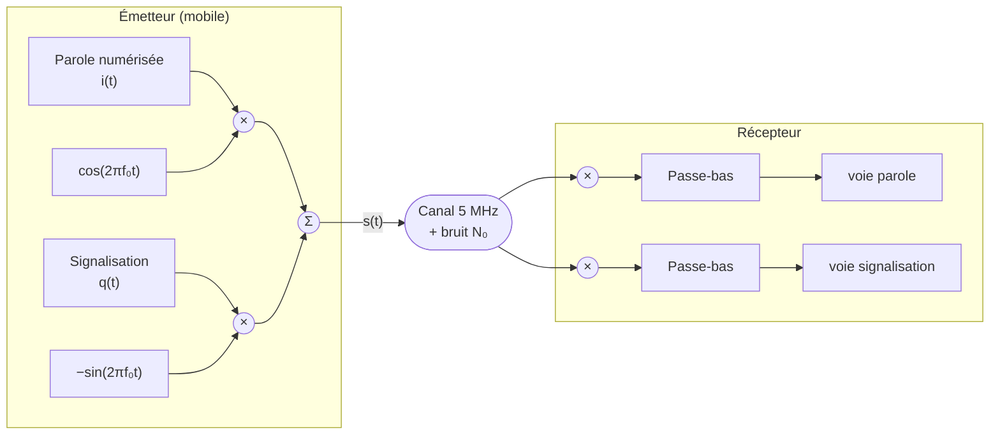
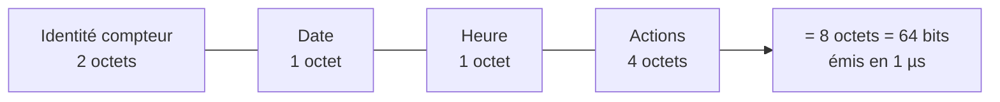

# TD1 — Modulations numériques
Retour : [[00 - Sommaire TSN-CLEAE2-NED]]

> [!info] Prérequis
> Ce TD mobilise les notions de [[03 - Modulations numériques]] et de [[02 - Récepteur optimal]] (filtre de Nyquist, IES, efficacité spectrale).

## Exercice 1 : Modulation d'amplitude en quadrature (MAQ-16)

On s'intéresse à une constellation de type **MAQ-16**. Les symboles transmis sur la voie en phase et sur la voie en quadrature prennent leur valeur dans le même alphabet $\{-(N-1)\alpha; \dots; -\alpha; \alpha; \dots; (N-1)\alpha\}$.

> [!question]- Q1 : Quelle doit être la valeur de $N$ pour avoir une MAQ-16 ?
> $M = N^2 = 16 \Rightarrow N = 4$. Chaque voie (I et Q) utilise donc un alphabet à 4 niveaux : $\{-3\alpha, -\alpha, \alpha, 3\alpha\}$.

> [!question]- Q2 : Diagramme de constellation en bande de base
> C'est une grille régulière de $4 \times 4 = 16$ points, aux coordonnées $(a_k, b_k)$ avec $a_k, b_k \in \{-3\alpha, -\alpha, \alpha, 3\alpha\}$ — voir [[03 - Modulations numériques#M-QAM (modulation d'amplitude en quadrature)]].
>
> ![[ned-constellations.svg]]
>
> (panneau de droite : la MAQ-16 avec un étiquetage de Gray)

> [!question]- Q3 : Intérêt de cette constellation par rapport à une MDP-16 et une MDA-16 ?
> ![[ned-td1-comparaison-16.svg]]
>
> La MAQ-16 répartit les points de façon **homogène** dans le plan complexe (grille régulière), contrairement à la MDA-16 (points alignés sur un axe) et à la MDP-16 (points sur un cercle, très rapprochés en phase). Pour une même énergie moyenne, la distance minimale $d_{min}$ entre symboles est plus grande en MAQ, ce qui réduit la probabilité d'erreur à énergie égale (voir [[03 - Modulations numériques#Comparaison des modulations linéaires]]).

## Exercice 2 : Le système UMTS

Le système UMTS (liaison montante) utilise une transmission binaire bipolaire à deux voies en quadrature : une voie de parole numérisée (signal $i(t)$) et une voie de signalisation (signal $q(t)$), toutes deux modulées en amplitude binaire avec un filtre de mise en forme en racine de cosinus surélevé, roll-off $\alpha = 22\%$, $T_s \approx 0{,}26042\ \mu s$.

$$s(t) = i(t)\cos(2\pi f_0 t) - q(t)\sin(2\pi f_0 t)$$

Bande allouée : canaux de 5 MHz entre 1885 et 2025 MHz. Bruit AWGN de densité spectrale $N_0 = 10^{-10}$ W/Hz. Démodulation par 2 multiplicateurs synchrones ($\cos(2\pi f_0 t)$ et $\sin(2\pi f_0 t)$) suivis d'un filtre passe-bas.

> [!question]- Q1 : Débit binaire par voie de communication
> Modulation binaire ⇒ $D = R = 1/T_s = 1/0{,}26042\ \mu s \approx 3{,}84$ Mbit/s.

> [!question]- Q2 : La démodulation de la voie de parole récupère-t-elle uniquement le canal de parole ?
> En multipliant $s(t)$ par $\cos(2\pi f_0 t)$ :
> $$s(t)\cos(2\pi f_0t) = i(t)\cos^2(2\pi f_0t) - q(t)\sin(2\pi f_0t)\cos(2\pi f_0t)$$
> $$= \frac{i(t)}{2}\big(1+\cos(4\pi f_0t)\big) - \frac{q(t)}{2}\sin(4\pi f_0t)$$
> Après filtrage passe-bas (élimination des termes en $4\pi f_0 t$), il ne reste que $i(t)/2$ : le terme en $q(t)$ disparaît car $\sin$ et $\cos$ sont **orthogonaux** sur une période. La voie de parole est donc bien récupérée seule, sans interférence de la voie de signalisation.

> [!question]- Q3 : Largeur de bande requise sans IES
> Filtre en cosinus surélevé, roll-off $\alpha=0{,}22$ : $B = \dfrac{1+\alpha}{T_s} = \dfrac{1{,}22}{0{,}26042\ \mu s} \approx 4{,}69$ MHz — compatible avec le canal de 5 MHz alloué.
>
> ![[ned-td1-occupation-spectrale.svg]]
>
> (en haut : l'UMTS tient dans son canal ; en bas, le cas de l'exercice 3)

> [!question]- Q4 : Efficacité spectrale du signal émis
> Le signal composite transporte les deux voies (parole + signalisation) sur la même bande : débit utile total $D_{tot} = 2 \times 3{,}84 = 7{,}68$ Mbit/s pour $B \approx 4{,}69$ MHz.
> $$\eta = \frac{D_{tot}}{B} \approx \frac{7{,}68}{4{,}69} \approx 1{,}64\ \text{bit/s/Hz}$$

> [!question]- Q5 : Énergie par bit requise pour $P_e < 10^{-3}$ sur le canal de parole
> Chaque voie étant une modulation binaire bipolaire (BPSK/2-ASK équivalent) : $P_e = Q\left(\sqrt{2E_b/N_0}\right)$.
> On cherche $E_b/N_0$ tel que $Q(x) = 10^{-3}$ : d'après la table de la fonction $Q$ (fournie en annexe du TD), $x \approx 3{,}09$.
> $$\frac{2E_b}{N_0} = x^2 \approx 9{,}55 \Rightarrow \frac{E_b}{N_0} \approx 4{,}77$$
> $$E_b \approx 4{,}77 \times N_0 = 4{,}77 \times 10^{-10} \approx 4{,}8\times 10^{-10}\ \text{J}$$

> [!question]- Q6 : Doubler le débit de la voie de signalisation (bande inchangée)
> Pour doubler le débit binaire d'une voie **sans augmenter la bande occupée** (donc sans changer $T_s$ ni le roll-off), il faut transmettre 2 bits par symbole au lieu d'un seul : passer d'une modulation binaire (2-ASK, $n=1$) à une **4-ASK** ($n=2$) sur cette voie.
>
> - Nouvelle efficacité spectrale de la voie de signalisation : doublée ($\eta$ double car $D$ double à $B$ constant).
> - Conséquence sur l'énergie par bit : à $P_e$ constant, une modulation d'ordre supérieur (4-ASK) présente une distance minimale $d_{min}$ plus faible pour une énergie moyenne donnée ⇒ il faut **augmenter l'énergie par bit** $E_b$ (donc la puissance d'émission) pour conserver la même probabilité d'erreur (voir la formule de $P_e$ pour une M-ASK dans [[03 - Modulations numériques#Performances d'une M-ASK]]).

## Exercice 3 : Système de télé-relevage par satellite

Système de télé-relevage de consommation électrique par satellite : liaison descendante (LD, satellite → compteur) et liaison montante (LM, compteur → satellite), en mode half-duplex, porteuse à 32 GHz (bande Ka), bande passante totale disponible de 50 MHz, puissance d'émission satellite 400 mW. On étudie uniquement la **liaison descendante**.

Une requête LD concatène : identité du compteur (2 octets), date (1 octet), heure (1 octet), actions à réaliser (4 octets) — soit un paquet de 8 octets, transmis en 1 µs.

> [!question]- Q1 : Débit $D_{LD}$ de la liaison descendante
> Paquet de $8 \times 8 = 64$ bits transmis en $1\ \mu s$ :
> $$D_{LD} = \frac{64\ \text{bits}}{1\ \mu s} = 64\ \text{Mbit/s}$$

Le satellite utilise une modulation d'amplitude M-aire à 4 états (4-ASK), filtrage global $g(t)$ en cosinus surélevé, roll-off $\alpha = 0{,}6$. Canal AWGN, $N_0 = 10^{-9}$ W/Hz.

> [!question]- Q2 : Rapidité de modulation du système LD
> $n = \log_2(4) = 2$ bits/symbole.
> $$R = \frac{D_{LD}}{n} = \frac{64}{2} = 32\ \text{MBd} \quad (T_s = 1/R \approx 31{,}25\ \text{ns})$$

> [!question]- Q3 : Transmission sans IES possible ?
> Bande nécessaire avec un cosinus surélevé de roll-off $\alpha=0{,}6$ :
> $$B = (1+\alpha) \times R = 1{,}6 \times 32 = 51{,}2\ \text{MHz}$$
> Cette bande **dépasse** les 50 MHz disponibles : la transmission sans interférence entre symboles **n'est pas garantie** avec ces paramètres.
>
> ![[ned-td1-occupation-spectrale.svg]]
>
> (en bas : les bords du spectre, en rouge, sortent du canal de 50 MHz)

> [!question]- Q4 : Diagramme de l'œil en sortie du filtre récepteur
> Puisque la bande nécessaire (51,2 MHz) dépasse légèrement la bande disponible (50 MHz), le filtrage réel introduit une légère IES résiduelle : le diagramme de l'œil correspondant est celui présentant une **ouverture verticale légèrement réduite** (et non un œil parfaitement ouvert, ni un œil complètement fermé) — cohérent avec un système fonctionnant proche de sa limite théorique de Nyquist plutôt qu'en deçà ou très au-delà.

> [!question]- Q5 : Efficacité spectrale de la LD
> $$\eta = \frac{D_{LD}}{B} = \frac{64}{50} = 1{,}28\ \text{bit/s/Hz} \quad \text{(sur la base de la bande disponible)}$$

> [!question]- Q6 : Probabilité d'erreur binaire (TEB) pour la LD
> Pour une M-ASK ($M=4$) :
> $$P_e = 2\,\frac{M-1}{M}\, Q\left(\sqrt{\frac{6\log_2(M)}{M^2-1}\cdot\frac{E_b}{N_0}}\right)$$
> Le calcul numérique nécessite l'énergie par bit $E_b$ (déduite de la puissance d'émission de 400 mW, du bilan de liaison et de $N_0 = 10^{-9}$ W/Hz) et la table de la fonction $Q$ fournie en annexe du sujet — se reporter au document original pour les valeurs numériques du bilan de liaison.

> [!question]- Q7 : Atteindre $P_e = 2 \times 10^{-4}$ sans changer le débit binaire
> Deux méthodes possibles, sans toucher à $D_{LD}$ :
> 1. **Augmenter la puissance d'émission** (donc $E_b$) pour réduire $P_e$ à $M$ constant — au prix d'une consommation énergétique accrue.
> 2. **Réduire l'ordre de la modulation** (par exemple passer de 4-ASK à 2-ASK) tout en augmentant la rapidité de modulation $R$ en proportion pour conserver le même débit binaire ($D = R \times n$) — ce qui améliore la distance minimale entre symboles (donc réduit $P_e$ à énergie égale) mais **augmente la bande passante occupée** ($B \propto R$), avec le risque de dépasser la bande disponible.
