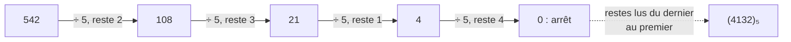
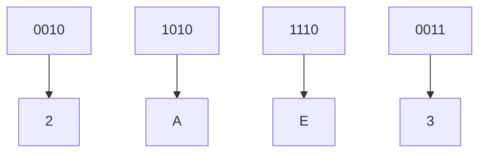
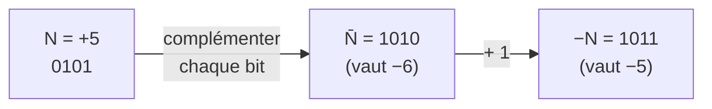
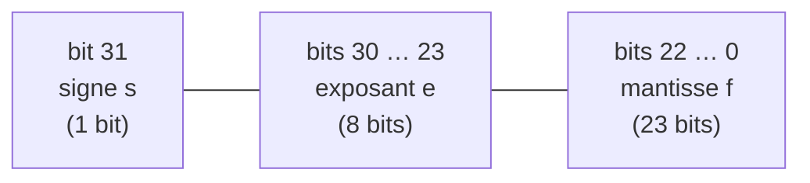

# Représentation des nombres

Retour : [[00 - Sommaire Techniques Numériques]] · Suite : [[02 - Logique combinatoire]]

Le traitement numérique de l'information repose sur des variables qui n'ont
que deux valeurs possibles : 0 ou 1. Les informations traitées peuvent être
très diverses (informations logiques, nombres, textes, images, sons...),
mais elles sont toutes ramenées à une représentation numérique universelle.
Les premières grandeurs codées sous forme de variables logiques sont les
**nombres** : les autres types d'information seront ensuite représentés par
des nombres, eux-mêmes représentés par des variables binaires. C'est pourquoi
ce cours débute par la représentation des nombres.

## 1. Les nombres entiers naturels

### 1.1. Les bases de numération

La numération traditionnelle représente un nombre par juxtaposition de
symboles appelés **chiffres**, pris parmi un ensemble. Dans le système
décimal (base 10), cet ensemble contient dix symboles : `{0,1,2,3,4,5,6,7,8,9}`.
Le nombre de symboles utilisés définit la **base** de numération.

Exemple en base 10 : `(3245)₁₀` se lit *trois mille deux cent quarante-cinq*,
c'est-à-dire `3×10³ + 2×10² + 4×10¹ + 5×10⁰`.

Les chiffres juxtaposés dans l'écriture d'un nombre sont donc les
**coefficients du polynôme** basé sur les puissances de la base. Cela se
généralise à une base `b` quelconque : si un nombre `N` s'écrit
`C₄C₃C₂C₁C₀`, sa valeur est :

$$N = C_4 \cdot b^4 + C_3 \cdot b^3 + C_2 \cdot b^2 + C_1 \cdot b^1 + C_0 \cdot b^0$$

Exemple en base 6 : `(3245)₆ = 3×6³ + 2×6² + 4×6 + 5 = (749)₁₀`

> [!tip] À retenir
> Un nombre écrit `Cₙ...C₁C₀` en base `b` vaut $N=\sum_i C_i \cdot b^i$.
> Il n'existe aucun symbole égal ou supérieur à `b` en base `b`, et le
> nombre `b` s'écrit toujours `(10)_b`, quelle que soit la base.

### 1.2. Conversion de base b en base 10

Il suffit de calculer le polynôme correspondant.

Exemple, à partir du binaire :
`(1010011)₂ = 1×2⁶+0×2⁵+1×2⁴+0×2³+0×2²+1×2¹+1×2⁰ = (83)₁₀`

### 1.3. Conversion de base 10 en base b

Deux méthodes :

1. **Reconstituer le polynôme** avec les puissances successives de `b`.
   Exemple : convertir `(542)₁₀` en base 5 : `542 = 0×625 + 4×125 + 1×25 + 3×5 + 2`,
   donc `(542)₁₀ = (4132)₅`.
2. **Divisions successives** (plus systématique) : diviser le nombre par la
   base, noter le reste, recommencer avec le quotient jusqu'à ce qu'il soit
   nul. Le résultat s'obtient en juxtaposant les restes en partant du dernier.

```text
542 / 5 = 108  reste 2
108 / 5 = 21   reste 3
21  / 5 = 4    reste 1
4   / 5 = 0    reste 4
→ (542)₁₀ = (4132)₅
```



## 2. Bases particulières

### 2.1. Le binaire

C'est la base 2, qui n'utilise que les chiffres 0 et 1. On associe souvent
0 à FAUX et 1 à VRAI (*logique positive*). Un chiffre binaire s'appelle un
**bit** (*binary digit*).

- Le bit de poids faible (le plus à droite) est le **LSB** (*Less
  Significant Bit*).
- Le bit de poids fort (le plus à gauche) est le **MSB** (*Most Significant
  Bit*).
- Avec `N` bits, on représente `2^N` valeurs différentes, de 0 à `2^N - 1`.

### 2.2. L'hexadécimal

C'est la base 16, plus compacte que le binaire pour les grands nombres.
Symboles : `0,1,2,3,4,5,6,7,8,9,A,B,C,D,E,F`.

Exemple : `(1EA)₁₆ = 1×256 + 14×16 + 10 = (490)₁₀`

La conversion binaire ↔ hexadécimal est immédiate : on groupe les bits par
paquets de 4.

```text
(10101011100011)₂ → 10│1010│1110│0011
                     2   A    E    3   → (2AE3)₁₆
```



On complète le groupe de gauche avec des 0 (`10` → `0010`) : les paquets se
forment toujours **à partir de la virgule** (ici, depuis la droite).

### 2.3. Le binaire naturel

| DÉCIMAL | BINAIRE | HEXA |
|---|---|---|
| 0 | 0000 | 0 |
| 1 | 0001 | 1 |
| 2 | 0010 | 2 |
| 3 | 0011 | 3 |
| 4 | 0100 | 4 |
| 5 | 0101 | 5 |
| 6 | 0110 | 6 |
| 7 | 0111 | 7 |
| 8 | 1000 | 8 |
| 9 | 1001 | 9 |
| 10 | 1010 | A |
| 11 | 1011 | B |
| 12 | 1100 | C |
| 13 | 1101 | D |
| 14 | 1110 | E |
| 15 | 1111 | F |

Le chiffre des unités change à chaque ligne, celui à sa gauche change toutes
les 2 lignes, le suivant toutes les 4 lignes, etc.

### 2.4. Le code de Gray

Le binaire naturel n'est pas la seule façon de coder les entiers en binaire.

| DÉCIMAL | BINAIRE | Code de Gray |
|---|---|---|
| 0 | 0000 | 0000 |
| 1 | 0001 | 0001 |
| 2 | 0010 | 0011 |
| 3 | 0011 | 0010 |
| 4 | 0100 | 0110 |
| 5 | 0101 | 0111 |
| 6 | 0110 | 0101 |
| 7 | 0111 | 0100 |
| 8 | 1000 | 1100 |
| 9 | 1001 | 1101 |
| 10 | 1010 | 1111 |
| 11 | 1011 | 1110 |
| 12 | 1100 | 1010 |
| 13 | 1101 | 1011 |
| 14 | 1110 | 1001 |
| 15 | 1111 | 1000 |

> [!tip] À retenir
> Entre 2 valeurs consécutives du code de Gray, un seul bit change à la
> fois. Cela évite les aléas de valeurs (par exemple sur un codeur de
> position angulaire optique).

## 3. Les entiers relatifs

Pour représenter des nombres positifs ou négatifs, on consacre le bit de
gauche au signe : `0` = positif, `1` = négatif. Il existe une mauvaise et une
bonne méthode.

### 3.1. Module et signe

On code la valeur absolue en binaire naturel et on ajoute un bit de signe.
**Mauvaise méthode** : le zéro est codé deux fois, et l'addition des entiers
naturels ne fonctionne plus pour les entiers relatifs.

### 3.2. Représentation en complément à 2

L'idée maîtresse : l'ordre d'écriture des nombres reste le même que pour les
entiers naturels.

| Décimal | Binaire | Complément à 2 |
|---|---|---|
| 0 | 0000 | 0 |
| 1 | 0001 | 1 |
| ... | ... | ... |
| 7 | 0111 | 7 |
| 8 | 1000 | -8 |
| 9 | 1001 | -7 |
| ... | ... | ... |
| 15 | 1111 | -1 |

Le bit de poids fort est le bit de signe. Le zéro n'est codé qu'une fois et
l'addition binaire fonctionne, que le bit de poids fort représente le signe
ou non.

### 3.3. Obtenir l'opposé d'un nombre

Quel que soit `k`, une suite de `k` bits à 1 vaut toujours -1
(`11111111 + 1 = 00000000`). En notant `N̄` le complément de `N` (chaque bit
inversé), on a `N̄ = -N - 1`, donc :

> [!tip] À retenir
> Pour obtenir l'opposé d'un nombre `N` codé en complément à 2 : on
> **complémente chaque bit** puis on **ajoute 1**.



## 4. Les nombres fractionnaires ou à virgule

### 4.1. Virgule fixe

En base 10 : `(32,45)₁₀ = 3×10¹+2×10⁰+4×10⁻¹+5×10⁻²`. On généralise à une
base quelconque, en particulier la base 2 :

`(1101,101)₂ = 1×2³+1×2²+0×2¹+1×2⁰+1×2⁻¹+0×2⁻²+1×2⁻³`

### 4.2. Conversion des nombres à virgule fixe

- Sens `b → 10` : on calcule le polynôme.
- Sens `10 → b` : on convertit la partie entière classiquement, puis on
  multiplie la partie fractionnaire par la base en gardant à chaque fois la
  partie entière du résultat.

Exemple : convertir `(37,65)₁₀` en binaire.

```text
Partie entière : (37)₁₀ = (100101)₂
0,65 × 2 = 1,30  → on retient 1
0,30 × 2 = 0,60  → on retient 0
0,60 × 2 = 1,20  → on retient 1
...
(37,65)₁₀ ≈ (100101,101…)₂
```

### 4.3. Virgule flottante — norme IEEE 754

C'est l'équivalent binaire de la notation scientifique décimale : on sépare
les chiffres significatifs (**mantisse**) de la puissance de la base
(**exposant**).

Codage IEEE 754 simple précision (32 bits, type `REAL`) :

| Bits | Rôle |
|---|---|
| 31 | signe `s` |
| 30 à 23 | exposant `e` |
| 22 à 0 | mantisse `f` (partie fractionnaire) |



$$N = (-1)^s \times 2^{e-127} \times 1,f \quad \text{avec } 0 < e < 255$$

- `s = 0` → positif, `s = 1` → négatif.
- Zéro s'écrit avec `e = 0` et `f = 0`.
- `e = 255` est réservé pour représenter l'infini (`+∞` ou `-∞`).
- Le 1 avant la virgule de la mantisse est **implicite** : il n'est pas
  stocké.

> [!warning] Piège
> Le bit le plus à gauche de la mantisse (`f`) est son bit de poids fort,
> mais ce n'est **pas** le même bit que le signe global du nombre.

> [!example] Exemple : coder −6,5
> 1. `6,5 = (110,1)₂ = 1,101 × 2²`
> 2. Signe : `s = 1` ; exposant : `e = 2 + 127 = 129 = (10000001)₂` ;
>    mantisse (sans le 1 implicite) : `f = 101 0000…0`
> 3. Mot de 32 bits : `1 │ 10000001 │ 10100000000000000000000` → `(C0D00000)₁₆`

## Exercices

> [!question]- Convertir `(42)₁₀` en base 3.
> `(1120)₃`

> [!question]- Convertir `(423)₅` en décimal.
> `(113)₁₀`

> [!question]- Convertir `(1230230120)₄` en hexadécimal.
> `(F,7E00)`... voir méthode détaillée dans [[TD1 - Représentation des nombres]].

> [!question]- Combien faut-il de bits au minimum pour représenter 34 en complément à 2 ? Donner sa représentation.
> 7 bits : `(0100010)₂`

> [!question]- On travaille sur 6 bits. Quelle valeur représente `(1100)₂` ? Et `(111010)₂` ?
> `(1100)₂ = 12` (en 6 bits : `001100`) ; `(111010)₂ = -6`

Voir la suite d'exercices corrigés dans [[TD1 - Représentation des nombres]].

## Révision
- QCM du module : [/qcm/](/qcm/) (catégorie « TechniquesNumeriques »)
