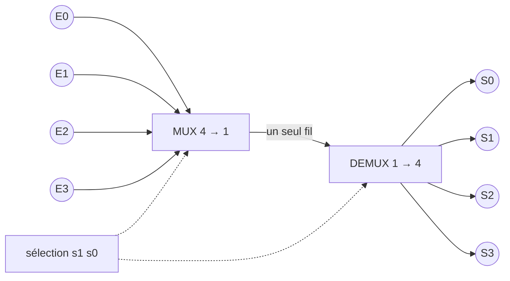
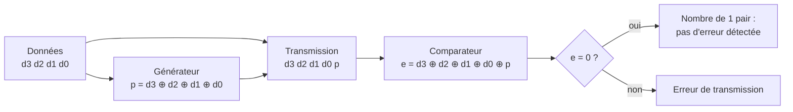
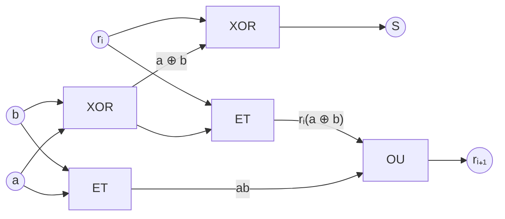
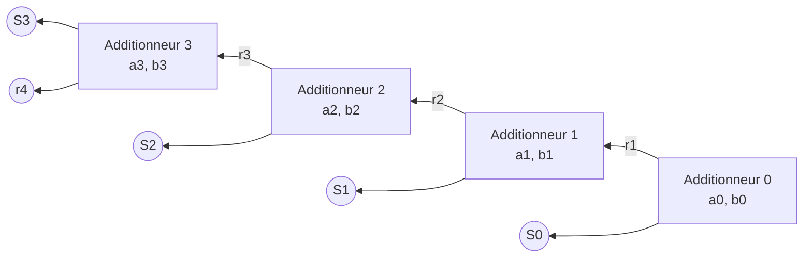
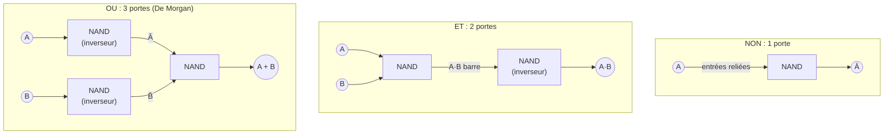

# Logique combinatoire

Retour : [[00 - Sommaire Techniques Numériques]] · Précédent : [[01 - Représentation des nombres]] · Suite : [[03 - Logique séquentielle]]

> [!abstract] Définition
> Un système **combinatoire** est un système dont les sorties ne dépendent
> que de l'état de ses entrées : il ne dépend pas de la chronologie.

## 1. Opérations sur les bits

### 1.1. Fonctions à 1 entrée

- **Fonction identité (OUI / soft / buffer)** : `S = E`
- **Fonction NON (inverseur)** : `S = Ē`

### 1.2. Fonctions à 2 entrées

Le comportement d'une fonction à 2 entrées se décrit par sa **table de
vérité**. Il y a 16 façons de la remplir, donc 16 fonctions logiques
différentes à 2 entrées. Les plus importantes :

| Fonction | Table de vérité | Symbole |
|---|---|---|
| **ET** (`AND`) | 1 seulement si E1=E2=1 | `&` |
| **NON-ET** (`NAND`) | complément du ET | `&` + rond |
| **OU** (`OR`) | 1 dès qu'une entrée vaut 1 | `≥1` |
| **NON-OU** (`NOR`) | complément du OU | `≥1` + rond |
| **OU EXCLUSIF** (`XOR`) | fonction différence : `S = E1 ⊕ E2` | `=1` |
| **NON-OU EXCLUSIF** (`XNOR`) | fonction égalité (coïncidence) | `=1` + rond |

```text
Table de vérité ET          Table de vérité OU
E1 E2 | S                   E1 E2 | S
0  0  | 0                   0  0  | 0
0  1  | 0                   0  1  | 1
1  0  | 0                   1  0  | 1
1  1  | 1                   1  1  | 1
```

> [!info] OU EXCLUSIF
> `S = E1 ⊕ E2 = E1·Ē2 + Ē1·E2`. C'est la fonction *différence* : elle vaut
> 1 si les entrées sont différentes.

## 2. Opérations sur les mots

Un **mot** est un groupe de bits (ex. un octet = 8 bits).

- **Opérations logiques** : ET, OU, OU EXCLUSIF... appliquées bit à bit.
  Exemple, un ET entre deux octets = 8 ET simultanés.
- **Opérations arithmétiques** : l'addition binaire s'effectue comme en
  base 10, colonne par colonne, en propageant la retenue.
- Autres opérations : comptage, décomptage, décalage à droite/à gauche,
  multiplication...

## 3. Méthodes d'étude


### 3.1. Algèbre de Boole

G. Boole (philosophe et mathématicien anglais, XIXᵉ siècle) a construit une
théorie du raisonnement à partir de propositions dont les seules réponses
sont VRAI (`1`) ou FAUX (`0`). L'ensemble des opérations qui en découle
forme l'**algèbre de Boole**, base de tous les systèmes numériques.

### 3.2. Définitions et notations

- Variables logiques `A, B, C...` : 2 valeurs possibles.
- Négation (complémentation) : `Ā`
- 2 lois internes : **ET** (noté `A·B` ou `AB`) et **OU** (noté `A+B`)
- Une fonction logique combine ces variables : ex. `F = A·(B+C)`

### 3.3. Propriétés

| Propriété | ET | OU |
|---|---|---|
| Élément neutre | `A·1 = A` | `A+0 = A` |
| Commutativité | `AB = BA` | `A+B = B+A` |
| Associativité | `A(BC) = (AB)C` | `A+(B+C) = (A+B)+C` |
| Idempotence | `A·A·A = A` (pas d'exposant) | `A+A+A = A` (pas de coefficient) |
| Absorption | `A·0 = 0` ; `A·(A+B) = A` | `A+1 = 1` ; `A+AB = A` |

Double distributivité : `A·(B+C) = AB+AC` et `A+(B·C) = (A+B)·(A+C)`

Propriétés du complément : `A + Ā = 1` et `A · Ā = 0`

**Lois de De Morgan :**

$$\overline{A+B} = \bar A \cdot \bar B \qquad \overline{A \cdot B} = \bar A + \bar B$$

> [!tip] Utilisation pratique
> Dans une expression comportant une barre de complémentation, on peut
> « couper » la barre au-dessus d'un opérateur en changeant en même temps
> cet opérateur (ET ↔ OU). Autre relation utile : `A + Ā·B = A + B`.

## 4. Les fonctions logiques

Une fonction à plusieurs variables se représente par une expression
algébrique (combinaison de ET/OU) **ou** par une table de vérité ; on passe
de l'une à l'autre.

### 4.1. Table de vérité

Pour une fonction à 3 variables, il y a `2³ = 8` lignes.

| N° ligne | A | B | C | F |
|---|---|---|---|---|
| 1 | 0 | 0 | 0 | 0 |
| 2 | 0 | 0 | 1 | 1 |
| 3 | 0 | 1 | 0 | 1 |
| 4 | 0 | 1 | 1 | 1 |
| 5 | 1 | 0 | 0 | 0 |
| 6 | 1 | 0 | 1 | 0 |
| 7 | 1 | 1 | 0 | 1 |
| 8 | 1 | 1 | 1 | 1 |

### 4.2. Développement par les « 1 »

On construit une somme de produits à partir des lignes où `F = 1` :

`F = Ā B C + Ā B C̄ + Ā B C ... ` (un terme par ligne à 1, chaque terme
regroupant les variables sous leur forme directe si elles valent 1, complémentée sinon).

### 4.3. Développement par les « 0 »

Même principe à partir des lignes où `F = 0`, ce qui donne l'expression de
`F̄` (une somme de produits), qu'il faut ensuite compléter pour obtenir `F`.

## 5. Simplification par le tableau de Karnaugh

Quand une seule variable change entre deux termes adjacents, cette variable
disparaît lors de la factorisation (ex. `ABC + AB̄C = AC`). Le **tableau de
Karnaugh** dispose les données de façon à visualiser directement ces
regroupements : entre deux lignes ou deux colonnes adjacentes, une seule
variable change.

> [!tip] Règles
> - La première et la dernière ligne (ou colonne) sont considérées comme
>   **adjacentes**.
> - Former des blocs de 1, 2, 4 ou 8 « 1 ».
> - Chaque « 1 » doit être exprimé **au moins une fois** (on peut
>   l'exprimer plusieurs fois).
> - Un bloc de « 1 » se traduit par un terme comprenant les variables
>   **communes** à tous les « 1 » du bloc.
> - Les valeurs indifférentes (« X », cas impossibles ou sans importance)
>   peuvent être prises à 0 ou à 1, au choix, pour agrandir les blocs.

### Exemple

```text
      BC
A   00 01 11 10
0    0  1  1  1
1    0  0  1  1
```

On obtient un groupe de 2 « 1 » (terme `ĀC`) et un groupe de 4 « 1 » (terme
`B`). Finalement : **`F = ĀC + B`**.

## 6. Les fonctions combinatoires usuelles

| Fonction | Rôle |
|---|---|
| **Codage** | Transformer `N` informations en un mot binaire (ex. clavier à 7 touches codé sur 3 bits) |
| **Décodage** | Opération inverse : mettre à 1 une seule sortie parmi `N`, celle dont l'indice est codé en entrée |
| **Multiplexeur** | Partager un fil de données entre plusieurs sources ; la sortie recopie l'entrée sélectionnée par un code binaire |
| **Démultiplexeur** | Opération inverse du multiplexeur |
| **Générateur de parité** | Ajoute un bit pour rendre pair (ou impair) le nombre total de « 1 » transmis — utilise le OU EXCLUSIF |
| **Comparateur de parité** | Vérifie, à la réception, que le nombre de « 1 » reçus est bien pair (détecte une erreur de transmission) |
| **Comparateur binaire** | `S = 1` si deux mots binaires sont identiques |
| **Additionneur** | Additionneur *demi* (2 entrées `a,b` → somme `S` et retenue `r`) ou *complet* (3 entrées `a, b, retenue rᵢ` → `S`, `rᵢ₊₁`) |

**Multiplexeur / démultiplexeur** : un seul fil transporte tour à tour les
données de 4 sources ; le même code de sélection `s1 s0` aiguille chaque
donnée vers la bonne destination.



**Contrôle de parité** (parité paire) :



Équations de l'additionneur complet :

$$S = a \oplus b \oplus r_i \qquad r_{i+1} = ab + ar_i + r_i b$$

On le construit avec deux demi-additionneurs et un OU, en remarquant que
$r_{i+1} = ab + r_i\,(a \oplus b)$ :



Pour additionner deux mots de `n` bits, on chaîne `n` additionneurs complets :
la retenue sortante de l'étage `i` entre dans l'étage `i+1`.



> [!example] Exemple de codeur (clavier 7 touches → 3 bits)
> `A = B4+B5+B6+B7`, `B = B2+B3+B6+B7`, `C = B1+B3+B5+B7`

> [!example]- Exercice : afficheur 7 segments
> Réaliser un décodeur 7 segments qui affiche le chiffre codé sur 4 bits
> `b3 b2 b1 b0`. Deux approches possibles :
> 1. Trouver directement l'équation logique de chaque segment à partir de
>    la table de vérité (7 fonctions de 4 variables).
> 2. Utiliser des circuits industriels existants (codage intermédiaire en
>    BCD avec un encodeur type `74LS148`, puis un décodeur BCD → 7 segments
>    type `74LS47`).

## Circuits intégrés usuels (TTL/CMOS)

| Circuit CMOS | Fonction |
|---|---|
| 4081 | Quadruple ET à 2 entrées |
| 4071 | Quadruple OU à 2 entrées |
| 4001 | Quadruple NON-OU à 2 entrées |
| 4011 | Quadruple NON-ET à 2 entrées |
| 4030 | Quadruple OU EXCLUSIF à 2 entrées |
| 4069 | Six inverseurs |

> [!tip] À retenir
> Le NON-ET (NAND) est un opérateur **universel** : on peut réaliser
> n'importe quelle fonction logique en ne combinant que des portes NAND
> (utile pour réduire le nombre de boîtiers différents dans une carte).



## Exercices

Voir la série complète d'exercices corrigés dans [[TD2 - Systèmes combinatoires]].

## Révision
- QCM du module : [/qcm/](/qcm/) (catégorie « TechniquesNumeriques »)
