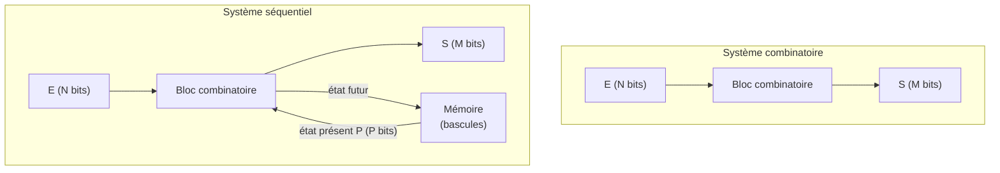
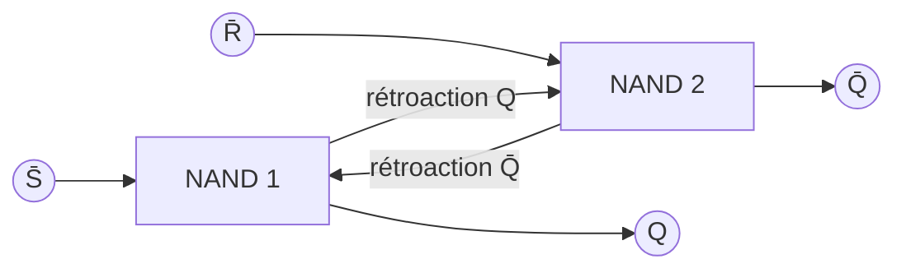
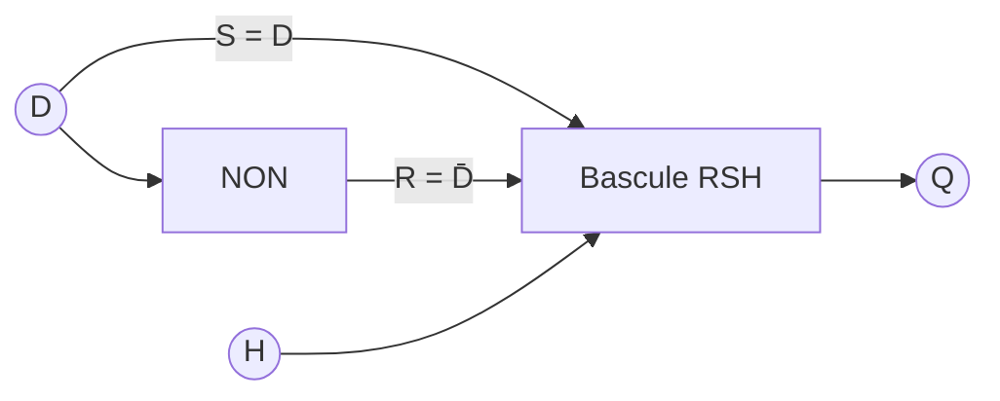
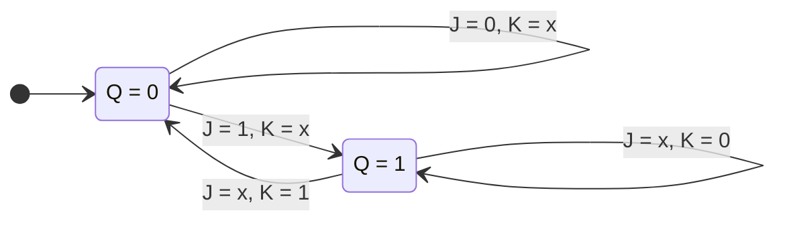
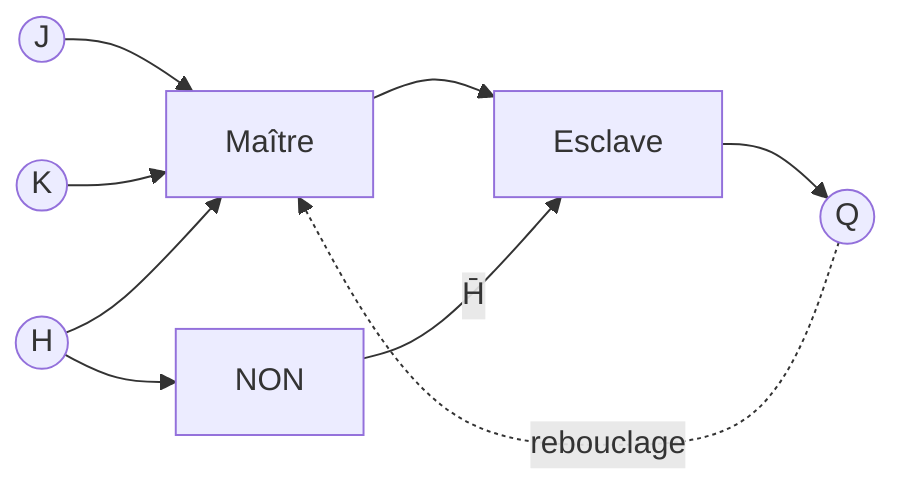
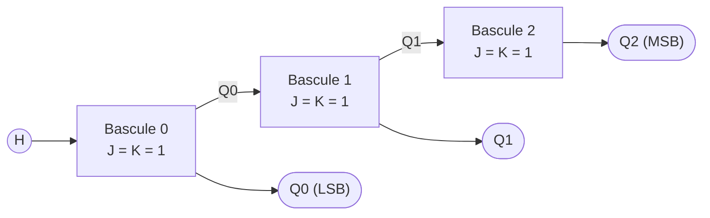
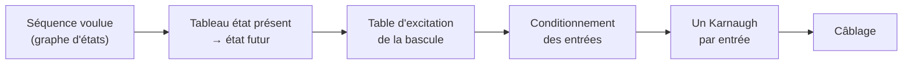
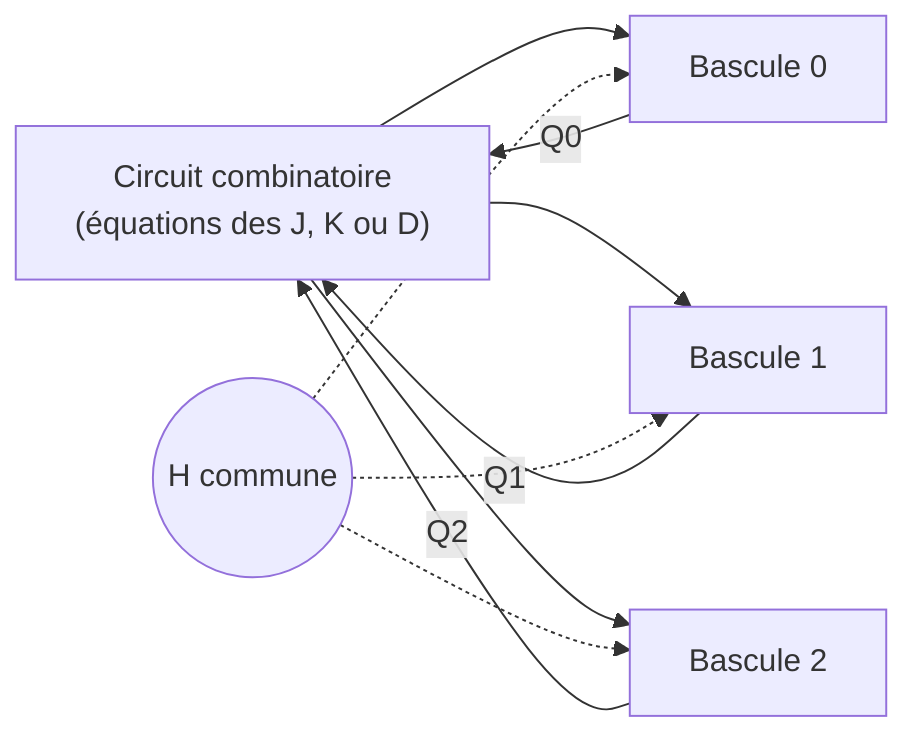
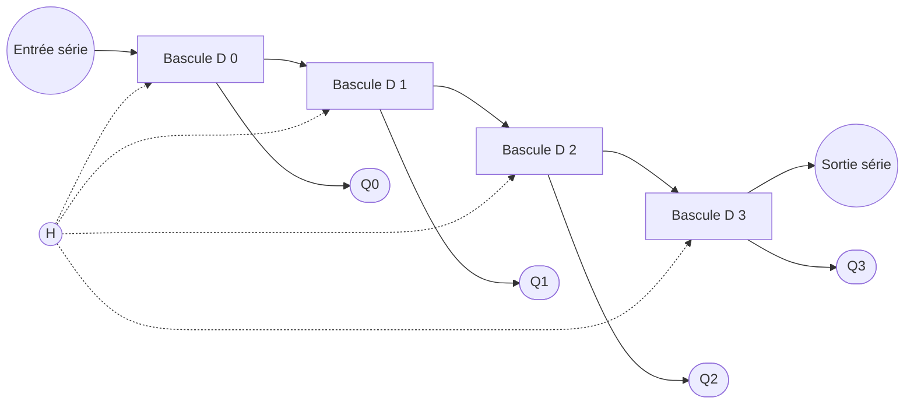

# Logique séquentielle

Retour : [[00 - Sommaire Techniques Numériques]] · Précédent : [[02 - Logique combinatoire]]

## 1. Définitions

### 1.1. Mise en situation

Imaginons un vérin simple effet commandé par 2 boutons poussoirs : un bouton
`S` (*Set*) le fait sortir (`Q=1`), un bouton `R` (*Reset*) le fait rentrer
(`Q=0`). Un dispositif mécanique interdit d'enfoncer les deux boutons
simultanément.

| Étape | S | R | Q |
|---|---|---|---|
| 1 | 1 | 0 | 1 |
| 2 | 0 | 0 | 1 |
| 3 | 0 | 1 | 0 |
| 4 | 0 | 0 | 0 |

> [!warning] Piège
> La même combinaison d'entrées `S=0, R=0` correspond aux étapes 2 **et** 4,
> qui pourtant donnent des sorties différentes (`Q=1` puis `Q=0`). **La
> sortie Q n'est donc pas une simple combinaison des entrées.**

Pour lever l'ambiguïté, il faut faire intervenir une **variable interne** `y`
qui représente l'état de la sortie *juste avant* la nouvelle combinaison des
entrées : `y(t) = Q(t⁻)`. En ajoutant cette colonne, toutes les
combinaisons `(S, R, y)` deviennent différentes : le tableau `(S, R, y) → Q`
s'appelle une **table d'implication**.

> [!important] Définition
> Un système qui est défini par l'état de ses entrées **et** par un ou
> plusieurs de ses états internes juste **avant** l'application des
> entrées, est un **système séquentiel**.

### 1.2. Schématisation

- Système **combinatoire** : `E (N bits) → [bloc combinatoire] → S (M bits)`
- Système **séquentiel** : le mot d'état interne `P` (P bits) reboucle en
  entrée du bloc combinatoire. **Un système séquentiel a une structure
  bouclée.**



### 1.3. Systèmes asynchrones et synchrones

- **Asynchrone** : la sortie répond « immédiatement » (au temps de
  propagation près) à toute modification des entrées. Sensible aux
  parasites externes et aux aléas de commutation.
- **Synchrone** : les entrées ne sont prises en compte qu'à des instants
  précis, rythmés par un signal d'**horloge** `H`. Deux modes de
  synchronisation :
  - sur **niveau** (haut ou bas) : les entrées sont actives tant que `H`
    est au niveau actif ;
  - sur **front** (montant ↑ ou descendant ↓, *edge-triggered*) : les
    entrées ne sont prises en compte que pendant la transition, ce qui
    permet un contrôle très précis des instants de commutation.

```text
H     ‾‾‾‾____‾‾‾‾____‾‾‾‾____
      ↑       ↑       ↑          front montant : seuls instants de prise en compte
      ‾‾‾‾    ‾‾‾‾    ‾‾‾‾       niveau haut : entrées actives pendant tout le palier
```

> [!tip] À retenir
> On privilégie le plus souvent les systèmes **synchrones sur front
> montant** : ils sont insensibles aux parasites hors de l'instant de
> synchronisation, et éliminent les aléas de commutation entre plusieurs
> circuits partageant la même horloge.

## 2. Les bascules

> [!important] Définition
> Une **bascule** (*flip-flop*) est un circuit logique **bistable** capable
> de stocker un bit d'information et de le maintenir dans le temps.

Ordre chronologique d'apparition : **RS → T → D → JK**. En pratique, on
utilise aujourd'hui principalement les bascules **D** et **JK** ; la bascule
**RS** garde quelques applications (ex. antirebond).

### 2.1. La bascule RS

C'est la première bascule apparue. Elle dispose de 2 entrées `R` et `S` qui
forcent respectivement la sortie `Q` à 0 et à 1.

| S | R | Qt | Qt+1 | |
|---|---|---|---|---|
| 0 | 0 | Qt | Qt | mémoire |
| 0 | 1 | x | 0 | mise à 0 (Reset) |
| 1 | 0 | x | 1 | mise à 1 (Set) |
| 1 | 1 | x | x | **combinaison interdite** |

Si le système combinatoire est en **boucle ouverte**, le système séquentiel
est un système combinatoire en **boucle(s) fermée(s)** : ce sont les
rétroactions qui créent la fonction mémoire.

Deux structures possibles : à base de portes **NAND** (entrées actives à 0,
notées `S̄`, `R̄`) ou de portes **NOR** (entrées actives à 1). Équation de la
structure à NAND :




$$Q_{t+1} = \bar R \cdot (Q_t + S) = \bar R \cdot S + \bar R \cdot Q_t$$

La commande `S = R = 1` (ou `S̄ = R̄ = 0` sur la version NAND) pose problème
au retour simultané à 0 : c'est l'opérateur le plus rapide qui impose son
état. Cette combinaison est donc considérée comme **interdite**.

**Table d'excitation** (entrées à appliquer pour obtenir la transition
voulue) :

| Qt | Qt+1 | S | R |
|---|---|---|---|
| 0 | 0 | 0 | x |
| 0 | 1 | 1 | 0 |
| 1 | 0 | 0 | 1 |
| 1 | 1 | x | 0 |

**Bascule RSH (ou RST)** : on ajoute une entrée d'horloge `H` pour rendre la
bascule RS synchrone. Si `H=0` : mode mémorisation quel que soient `R, S`. Si
`H=1` : fonctionnement normal.

### 2.2. La bascule D

Dérivée de la RSH en ajoutant un inverseur entre les entrées `S` et `R` :
une seule entrée `D`, avec `D = S` et `D̄ = R`. La combinaison interdite
devient **impossible** puisque `S` et `R` sont toujours complémentaires.



- Si `H` est actif : `Q` recopie `D`.
- Si `H` est inactif : `Q` ne change pas (mémoire).

Table d'excitation : `Qt+1 = D` (indépendamment de `Qt`).

Deux variantes :
- **D latch** : synchronisée sur **niveau** haut (ou bas) de l'horloge.
- **D edge-triggered (flip-flop)** : synchronisée sur **front** montant (ou
  descendant).

Beaucoup de bascules D intégrées (ex. `74LS74`) possèdent en plus 2 entrées
de forçage **asynchrones** `S` et `R`, prioritaires sur le fonctionnement
synchrone.

### 2.3. La bascule JK

Deux entrées `J` (mise à 1) et `K` (mise à 0), sans plus aucun état
interdit : la combinaison `J=K=1` fait **basculer** systématiquement la
sortie (mode commutation).

| J | K | Qt | Qt+1 | |
|---|---|---|---|---|
| 0 | 0 | Qt | Qt | mémoire |
| 0 | 1 | x | 0 | mise à 0 |
| 1 | 0 | x | 1 | mise à 1 |
| 1 | 1 | Q̄t | Q̄t | commutation |

D'où : $Q_{t+1} = J \bar Q_t + \bar K Q_t$

**Table d'excitation :**

| Qt | Qt+1 | J | K |
|---|---|---|---|
| 0 | 0 | 0 | x |
| 0 | 1 | 1 | x |
| 1 | 0 | x | 1 |
| 1 | 1 | x | 0 |

Le même comportement sous forme de **graphe d'états** (chaque flèche = un
front d'horloge) :



> [!tip] Lien RS ↔ JK
> On peut fabriquer une bascule JK à partir d'une bascule RS avec `R = K·Qt`
> et `S = J·Q̄t`.

**Bascules maître-esclave (Master-Slave)** : 2 cellules élémentaires en
série. L'information est chargée dans le *maître* puis transférée à
l'*esclave*. Variante « *data lock out* » (ex. `74LS110`) : chargement sur le
front descendant de l'horloge, transfert sur le front montant.



## 3. Les compteurs

> [!important] Définition
> Un **compteur** est un circuit logique séquentiel dont la sortie codée sur
> `n` bits change d'état à chaque impulsion d'horloge.

Vocabulaire :
- **Comptage / décomptage** : incrémenter / décrémenter le compteur à
  chaque impulsion.
- **Initialisation** : positionner toutes les bascules à une valeur
  déterminée (entrée souvent asynchrone et prioritaire).
- **Séquence complète (modulo `2ⁿ`)** : tous les états possibles sont
  utilisés. **Séquence incomplète (modulo `M < 2ⁿ`)** : sinon.
- **Compteur asynchrone** : chaque bascule est déclenchée par la
  précédente (l'horloge ne déclenche que la première).
- **Compteur synchrone** : toutes les bascules reçoivent le même signal
  d'horloge.

### 3.1. Compteurs asynchrones

Les plus simples à réaliser, mais ils présentent un risque d'**états
transitoires** indésirables dus aux temps de propagation cumulés des
bascules en cascade (dans le pire cas, la sortie n'est stabilisée qu'après
`n·tp`, `tp` étant le temps de propagation d'une bascule).

- **Séquence complète** (ex. modulo 16) : `n` bascules D (ou JK/T) en
  cascade, chacune déclenchée par la précédente.



Chronogramme d'un compteur modulo 8 (bascules sur **front descendant**) :
chaque sortie change d'état quand la précédente passe de 1 à 0, ce qui
divise la fréquence par 2 à chaque étage.

```text
H    ‾‾__‾‾__‾‾__‾‾__‾‾__‾‾__‾‾__‾‾__‾‾__
Q0   __‾‾‾‾____‾‾‾‾____‾‾‾‾____‾‾‾‾____‾‾
Q1   ______‾‾‾‾‾‾‾‾________‾‾‾‾‾‾‾‾______
Q2   ______________‾‾‾‾‾‾‾‾‾‾‾‾‾‾‾‾______
N      0   1   2   3   4   5   6   7   0
```
- **Séquence incomplète** (ex. décade DCB modulo 10) : il faut décoder
  l'état `M` pour forcer une remise à zéro (RAZ) du compteur.
- **Décompteur** : on utilise les sorties `Q̄ᵢ` au lieu de `Qᵢ`, ou on
  déclenche la bascule suivante sur le front opposé.

### 3.2. Compteurs synchrones — synthèse par la méthode de Marcus

Objectif : éliminer les états transitoires en utilisant des bascules
identiques recevant toutes le même signal d'horloge, précédées d'un circuit
combinatoire qui calcule les entrées de chaque bascule.




**Méthode :**
1. Dresser un tableau **état présent → état futur** pour la séquence
   voulue.
2. En déduire, grâce à la **table d'excitation** de la bascule choisie
   (D ou JK), le **conditionnement des entrées** de chaque bascule.
3. Simplifier chaque entrée avec un tableau de Karnaugh (en tenant compte
   des états indifférents `x` pour les états hors séquence).
4. Câbler le circuit combinatoire obtenu en entrée de chaque bascule.



> [!example] Exemple — compteur modulo 5 (séquence 0,1,2,3,4,0,...)
> Avec des bascules JK, on établit le tableau état présent / état futur /
> conditionnement, puis on extrait de chaque tableau de Karnaugh :
> `J2=Q1Q0`, `K2=1`, `J1=Q0`, `K1=Q0`, `J0=Q̄2`, `K0=1`.
> Avec des bascules D : `D2=Q1Q0`, `D1=Q̄1Q0+Q1Q̄0 = Q1⊕Q0`, `D0=Q̄2·Q̄0`.
>
> ```mermaid
> stateDiagram-v2
>     direction LR
>     s0: 000
>     s1: 001
>     s2: 010
>     s3: 011
>     s4: 100
>     s5: 101 (hors séquence)
>     s6: 110 (hors séquence)
>     s7: 111 (hors séquence)
>     [*] --> s0
>     s0 --> s1
>     s1 --> s2
>     s2 --> s3
>     s3 --> s4
>     s4 --> s0
>     s5 --> s2
>     s6 --> s2
>     s7 --> s0
> ```
> Les états hors séquence rejoignent le cycle en un coup d'horloge (ici
> avec les équations JK) : le compteur **ne peut pas se bloquer**.

> [!example] Exemple — séquence 7→6→5→4→3→2→7→6...
> Synthèse avec des bascules JK : après remplissage des tableaux de
> Karnaugh de chaque entrée en exploitant les états indifférents (états
> 0 et 1, hors séquence), on obtient :
> `J2 = Q̄0`, `K2 = Q̄1·Q̄0`, `J1 = Q̄0`, `K1 = Q2·Q̄0`, `J0 = 1`, `K0 = 1`.
>
> ```mermaid
> stateDiagram-v2
>     direction LR
>     s7: 111 (7)
>     s6: 110 (6)
>     s5: 101 (5)
>     s4: 100 (4)
>     s3: 011 (3)
>     s2: 010 (2)
>     s1: 001 (1, hors séquence)
>     s0: 000 (0, hors séquence)
>     s7 --> s6
>     s6 --> s5
>     s5 --> s4
>     s4 --> s3
>     s3 --> s2
>     s2 --> s7
>     s1 --> s0
>     s0 --> s7
> ```

> [!tip] À retenir
> La méthode de Marcus se résume toujours en 3 tableaux côte à côte :
> **état présent | état futur | conditionnement des entrées des bascules**,
> suivis d'un tableau de Karnaugh par entrée.

## 4. Les registres à décalage

> [!important] Définition
> Un **registre à décalage** est un circuit séquentiel composé de bascules
> synchrones (D ou JK) connectées en série, cadencées par une horloge
> commune. Il permet de **stocker** temporairement des données binaires et
> de les **décaler** d'une position à la suivante (vers la gauche ou vers
> la droite) à chaque impulsion d'horloge.

La sortie de la bascule de rang `i` est connectée à l'entrée de la bascule
de rang `i+1`. Le sens de décalage (gauche/droite) permet de réaliser très
rapidement une opération de **×2** ou **/2**.



Exemple : chargement série du mot `1011` (bit de poids faible en premier),
registre initialement à 0.

| Front d'horloge | Bit entrant | Q0 | Q1 | Q2 | Q3 |
|---|---|---|---|---|---|
| — | — | 0 | 0 | 0 | 0 |
| 1 | 1 | 1 | 0 | 0 | 0 |
| 2 | 1 | 1 | 1 | 0 | 0 |
| 3 | 0 | 0 | 1 | 1 | 0 |
| 4 | 1 | 1 | 0 | 1 | 1 |

Après 4 fronts, le mot est disponible en parallèle : `Q0 Q1 Q2 Q3 = 1011` (le dernier bit entré, le MSB, est dans Q0).

### Modes de fonctionnement

**Écriture :**
- **Chargement parallèle** : chaque bit du mot à charger est connecté
  directement à l'entrée de la bascule correspondante (chargement en un
  seul coup d'horloge).
- **Chargement série** : le mot est présenté bit à bit sur l'entrée de la
  première bascule ; à chaque top d'horloge, un nouveau bit entre pendant
  que les bits déjà mémorisés se décalent d'un rang.

**Lecture :** en série (sortie de la dernière bascule) ou en parallèle
(sortie de chacune des bascules).

Il existe donc 4 grandes familles de registres : **SISO** (série/série),
**SIPO** (série/parallèle), **PISO** (parallèle/série), **PIPO**
(parallèle/parallèle).

### Registre à décalage universel

Un registre « universel » combine tous les modes d'entrée et de sortie. Le
circuit **74LS194** (*4-bit bidirectional universal shift register*) en est
un exemple industriel courant : il propose 4 modes de fonctionnement
sélectionnés par 2 entrées de commande `S1 S0` :

| S1 | S0 | Mode |
|---|---|---|
| 0 | 0 | inhibition (mémorisation) |
| 0 | 1 | décalage à droite (entrée série *SR SER*) |
| 1 | 0 | décalage à gauche (entrée série *SL SER*) |
| 1 | 1 | chargement parallèle synchrone (entrées A,B,C,D) |

Il dispose aussi d'une entrée `CLR` de remise à zéro **asynchrone
prioritaire**, et d'une horloge active sur front montant.

> [!tip] À retenir
> Le sens de décalage (droite `Qₐ→Q_D` ou gauche `Q_D→Qₐ`) est purement
> **topologique** : c'est le câblage qui définit ce que signifie « gauche »
> et « droite » pour le registre.

## Exercices

Voir la série complète d'exercices corrigés dans [[TD3 - Systèmes séquentiels]].

## Révision
- QCM du module : [/qcm/](/qcm/) (catégorie « TechniquesNumeriques »)
