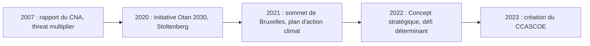

# Changement climatique : défi et opportunité pour l'Otan
Retour : [[00 - Sommaire Sigem 2026]] · Précédent : [[03 - Éviter le déclassement stratégique]] · Suite : [[05 - Combat de haute intensité, IA et robotique]]

> [!abstract] Résumé
> Le changement climatique menace directement les armées (infrastructures, entraînement, matériels) et multiplie leurs missions de secours. L'Otan s'est saisie du sujet depuis 2021, mais l'élan s'essouffle. À terme, les **émissions de carbone** pourraient peser sur la **moralité et la légalité** des guerres et pousser l'Otan à **réinterpréter l'article 5** : d'une alliance militaire vers une **alliance sécuritaire**.

## Un réchauffement d'origine humaine
- L'**effet de serre** est un phénomène naturel et **nécessaire** à la vie sur Terre.
- Ce qui ne l'est pas : l'**ampleur** et la **rapidité** du réchauffement depuis la révolution industrielle → il est **causé par l'homme** (rapport de synthèse du **GIEC/IPCC**, 2023).
- Effets : montée du niveau de la mer (fonte des glaces terrestres), phénomènes extrêmes (sécheresses, précipitations, inondations), incendies, migration des agents pathogènes vers le nord.

Beaucoup d'acteurs y voient une **menace pour la sécurité mondiale**, sans s'accorder sur **qui** est menacé ni **quoi** faire : certains se sentent menacés par l'**action climatique** (qui remet en cause leur mode de vie carboné, ex. le parti AfD), d'autres par l'**absence d'action** (ex. *Fridays for Future*, Greta Thunberg).

### Trois « lentilles » de la sécurité
Les **études de sécurité** (sous-domaine des Relations internationales) regardent le même sujet sous différents angles — comme les tableaux de **Cézanne** sur la montagne Sainte-Victoire :

| Perspective | Ce qui est menacé |
|---|---|
| **Sécurité humaine** | Les individus et leurs moyens d'existence, surtout les populations vulnérables vivant de la terre |
| **Sécurité nationale** | L'État : combiné à des **institutions faibles**, le climat peut mener à des conflits violents, rébellions, résistances — d'où l'intervention des militaires comme gardiens de la paix |
| **Sécurité militaire** | Les armées elles-mêmes : le climat contraint leur organisation et leur conduite |

## Les menaces climatiques pour les armées
1. **Dégâts aux infrastructures** : des millions de livres de dommages ; deux ouragans (2018 et 2020) ont causé **4 milliards de dollars** de dégâts à deux bases américaines.
2. **Chaleur** : l'entraînement et le combat deviennent plus difficiles (près de **50 °C** pour l'armée britannique en Irak) ; les équipements (navires, hélicoptères) en souffrent. Une étude montre que la météo pourrait même **hypothéquer la dissuasion nucléaire de l'Otan**.
3. **Secours en cas de catastrophe** : les armées y ont un savoir-faire inégalé et ce rôle croît fortement. Pour l'Otan, il est institutionnalisé via l'**EADRCC** (Centre euro-atlantique de coordination des réactions en cas de catastrophe).

> [!warning] Le risque du « détournement de mission »
> La fréquence des interventions de soutien fait craindre que les militaires soient **empêchés de faire leur vrai travail**.

> [!tip] À retenir
> En 2007, le rapport du **CNA** (*Center for Naval Analyses*) *National Security and the Threat of Climate Change* qualifie le changement climatique de « **multiplicateur de menaces** » (*threat multiplier*).

## La prise en compte par l'Otan

- L'Otan s'y intéresse **tardivement** : **Sommet de Bruxelles (2021)** → *Climate Change and Security Action Plan*.
- Rôle décisif de **Jens Stoltenberg**, ancien émissaire de l'ONU pour le climat, qui a utilisé l'initiative **Otan 2030**.
- **Concept stratégique 2022** : le climat est « un **défi déterminant de notre époque** » ; l'Otan doit devenir « le **premier organisme international** en matière de compréhension et d'adaptation » à son impact sur la sécurité.

### Les quatre axes du plan d'action (2021)

| Axe | Outil principal |
|---|---|
| **Prise de conscience** | *Climate Change and Security Impact Assessment*, publié chaque année : impact sur chaque domaine (mer, terre, air, Espace, cyber), sur les missions (ex. **KFOR** au Kosovo) et sur la résilience civile |
| **Adaptation** | Recueil annuel de **meilleures pratiques** (*Compendium of Best Practices*) : cas réels d'adaptation des bases et missions, guide pour les commandants |
| **Atténuation** | **Cartographie des émissions de GES** et méthodologie analytique de l'empreinte carbone des matériels et installations |
| **Sensibilisation** (société civile, alliés, armées hors Otan) | Discours du Secrétaire général ; **CCASCOE** (Centre d'excellence pour le changement climatique et la sécurité, depuis 2023) |

## Des perspectives contradictoires
Après les interventions de Stoltenberg, la rhétorique sur la sécurité climatique est **au point mort**. Deux tendances s'opposent :

- **Recul** : la sécurité climatique passe au second plan face aux conflits entre grandes puissances (Otan contre Russie, Otan menée par les États-Unis contre Chine). **Donald Trump** retire les États-Unis de l'**Accord de Paris** et arrête le financement de l'**IRA** (*Inflation Reduction Act*).
- **Pression croissante** : sans action, les températures grimperont ; les armées seront **accaparées** par les secours, les soldats subiront les effets du climat et les **conflits climatiques** deviendront probables.

## Armées, guerres, émissions et morale
- En temps de paix, l'empreinte carbone des armées représente **5,5 % des émissions mondiales** de GES.
- L'empreinte de la **guerre** (combat, logistique, reconstruction) attire l'attention : les émissions des guerres d'**Ukraine** et de **Gaza** ont été cartographiées en quasi temps réel. Les **60 premiers jours** de la guerre de Gaza ont émis **plus que 20 pays et territoires en un an**.
- Les conflits très émetteurs risquent d'être jugés **non éthiques** par les populations ayant une conscience climatique.
- Devant la **CIJ** (décembre 2024), la Palestine a demandé d'inclure les émissions de guerre dans les obligations climatiques des États.

> [!important] Prévision de l'auteure
> Les émissions prévisibles de carbone joueront un rôle dans le calcul de **proportionnalité**, tant pour **entrer en guerre** (*jus ad bellum*) que pour les **actes de guerre** (*jus in bello*). Le droit des conflits protège déjà l'environnement (il proscrit la **guerre environnementale**) et pourrait être étendu aux émissions, par exemple en **interdisant les armements les plus émetteurs**.

Pour les alliés européens, préserver l'**ordre fondé sur des règles** est d'autant plus important que Trump le démantèle de l'intérieur.

## Deux réponses concrètes pour l'Otan

### 1. La guerre « verte » (*low-carbon warfare*)
- Carburants **verts et durables** (biocarburants), **solaire**, voire **petits réacteurs nucléaires**.
- Technologies de **séquestration du carbone** dans les bases et camps.
- Moyens alternatifs : **drones électriques**, **guerre cyber**.

### 2. Réinterpréter l'article 5
L'**article 5 du Traité de Washington** (défense collective) prévoit qu'une **attaque armée** contre un membre est une attaque contre tous, chacun prenant les mesures qu'il juge nécessaires.

- Le climat montre que les menaces ne sont plus forcément **intentionnelles ni attribuables**.
- Nouvelles menaces possibles : **sabotage d'installations de géo-ingénierie**, **mainmise sur les terres ou l'eau** (détourner un fleuve) — graves mais **non armées**.
- Précédent : depuis **2021**, le **cyber** relève de l'article 5 → la défense collective ne vise plus seulement les attaques armées, et la riposte n'est **pas forcément armée**. **Jamie Shea** : « l'utilisation de l'article 5 est en train de changer », la réponse sera déterminée **au cas par cas**.

| Évaluation | Arguments |
|---|---|
| **Risques** | Une réponse **moindre** (sanctions plutôt que force) et **trop fréquente** affaiblit l'**effet dissuasif** de l'Otan |
| **Avantages** | Réagir **plus vite** (occasion manquée face à la Russie en Ukraine, compensée ensuite par un soutien extraordinaire) ; prévenir des guerres ; plus forte **volonté d'agir** des alliés (les freins portent sur l'emploi de la force, pas sur les interventions d'urgence) ; **renforcement politique** de l'Alliance |

L'auteure est **modérément optimiste** : une réponse armée reste possible si des moyens moins agressifs sont employés d'abord.

> [!tip] À retenir
> Le défi climatique pourrait transformer l'Otan **d'une alliance militaire en une alliance sécuritaire**, plus dynamique, ciblée et réactive — et, en répondant collectivement, **plus unie**.

> [!question]- Exercice : quels sont les quatre axes du plan d'action climat de l'Otan ?
> Prise de conscience, adaptation, atténuation, sensibilisation.

> [!question]- Exercice : pourquoi l'inclusion du cyber dans l'article 5 est-elle un précédent pour le climat ?
> Elle montre que la défense collective peut être déclenchée par une attaque non armée et que la riposte n'est pas forcément armée : l'article 5 devient d'application variable, au cas par cas.

> [!question]- Exercice : que signifient *jus ad bellum* et *jus in bello* ?
> *Jus ad bellum* : le droit de recourir à la guerre (légitimité d'entrer en guerre). *Jus in bello* : le droit applicable dans la conduite de la guerre (actes de guerre).
