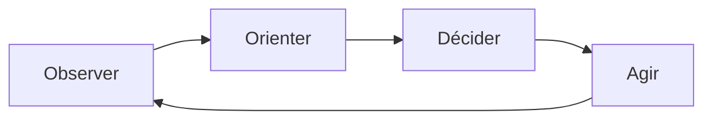

# Les tendances du combat de haute intensité : IA et robotique
Retour : [[00 - Sommaire Sigem 2026]] · Précédent : [[04 - Changement climatique et Otan]] · Suite : [[06 - La donnée et la guerre]]

> [!abstract] Résumé
> Les conflits récents (Arménie, Yémen, Ukraine, Israël) confirment trois tendances : **intensité croissante**, **robotisation** de tous les milieux et **rôle croissant de l'IA**. La massification de moyens bon marché (drones, essaims, impression 3D) et l'accélération de la **boucle OODA** structurent le combat de haute intensité de la prochaine décennie.

## Trois tendances confirmées
1. **Augmentation régulière de l'intensité du combat.**
2. **Robotisation du champ de bataille** dans tous les milieux : terre, air, mer.
3. **Rôle croissant de l'intelligence artificielle** :
   - systèmes d'**aide à la décision** et de **commandement** ;
   - **autonomisation** des systèmes robotisés (niveaux L0 à L5, voir [[#Annexe — les niveaux d'autonomie L0 à L5]]) ;
   - **renseignement** : traitement automatique de grands volumes (capteurs, imagerie géospatiale) ;
   - **simulation**, notamment l'**apprentissage par renforcement** (*Reinforcement Learning*, RL) pour les manœuvres d'escadrilles et d'essaims de drones.

> [!info] Définitions
> - **Reinforcement Learning** : un agent apprend de façon autonome à choisir ses actions en recevant **récompenses ou pénalités** ; il cherche la stratégie qui maximise les récompenses cumulées.
> - **Machine Learning** : des algorithmes découvrent des **motifs récurrents** (*patterns*) dans les données pour améliorer leurs performances sur une tâche.

## Les tendances fortes à court et moyen termes

| Tendance | Explication |
|---|---|
| **L'économie du sang** | Retirer le soldat de la première zone de confrontation et le remplacer par des robots très autonomes : exigence sociétale des démocraties |
| **La saturation de l'espace de combat** | Par l'IA et la robotique **en essaims** ; combat **SCS** (*Swarm Counter Swarm*, essaim contre essaim) |
| **La réduction des délais de la boucle OODA** | Observer – Orienter – Décider – Agir : accélérée par l'IA et l'autonomisation des systèmes et des processus de décision |
| **La massification des moyens** | Déployer une énergie de combat maximale ; les facteurs **économiques et logistiques** produisent l'intensité |

### Massifier : deux questions et des réponses
La massification pose deux questions centrales :

- Comment mettre en œuvre des systèmes de haute intensité **dans la durée** ?
- Comment créer de l'**attrition** chez l'adversaire en **minimisant le coût** des armes et munitions ?

Préconisations (liste non exhaustive) :

- **Munitions téléopérées (MTO)** multi-milieux à **bas coût** ;
- généralisation de la **robotique en essaim** pour saturer les défenses ;
- **impression 3D / additive** des châssis de drones ;
- **unités/usines mobiles** projetables près de la zone de conflit ;
- **blockchains privées** de qualité militaire pour la **traçabilité** des pièces de maintenance produites près du front ;
- préparation de mission par **simulation / ML-RL** et optimisation espace-temps ;
- **automatisation du renseignement** : ML, vision par ordinateur (*Computer Vision*), IA générative, **LLM multimodaux** (grands modèles de langage) ;
- **IA-C2** dans les centres de commandement pour réduire la boucle OODA.

## La robotique militaire par milieu

### Le domaine aérien
Du **nano-drone** de quelques dizaines de grammes au **drone d'attaque** de plusieurs tonnes, proche de l'aéronef de combat.

| Catégorie | Masse | Altitude de vol | Vitesse |
|---|---|---|---|
| Groupe 1 | < 9 kg | < 365 m | < 100 km |
| Groupe 2 | 9-25 kg | < 1 000 m | < 250 km |
| Groupe 3 | 25-600 kg | < 5 500 m | < 250 km |
| Groupe 4 | > 600 kg | < 5 500 m | Sans limitation |
| Groupe 5 | > 600 kg | < 5 500 m | Sans limitation |

> [!note] Note sur le tableau
> Valeurs reproduites telles qu'elles figurent dans l'article. Dans la classification américaine dont il est issu, le groupe 5 se distingue du groupe 4 par une altitude **supérieure** à 5 500 m.

- **Drones tactiques** : longue endurance, persistance, **furtivité**, silence, faible consommation, **vol plané moteur coupé** pour réduire l'empreinte radar.
- **Petits drones et MTO** : production massive de **drones kamikazes** « bon marché » portant **500 g à 3 kg d'explosifs** ; coût abaissé par l'impression 3D ; **essaims** avec algorithmes dédiés et navigation **sans GPS** (*GPS denied*) en zone brouillée. Exemple : le drone ukrainien **Backfire**, capable de pénétrer **plus de 35 km** en vol autonome, peu sensible au brouillage.
- **Drones Racers** : hyper-manœuvrants, autopilotes à base de RL ; depuis **août 2023**, le RL **surpasse le meilleur pilote humain**.
- **Lutte anti-drones (LAD)** / SCS : radars de détection des petits drones, autopilotes capables de marquage, suivi et **interception automatique** (plateforme française **Aristée**, du nom du demi-dieu des abeilles).

### Le domaine naval
- **Essaims de drones de surface** généralisés : expérimentés par la Turquie, l'Ukraine, la Chine, l'Iran, Israël, les États-Unis, la Russie. La **mer Noire** est devenue un laboratoire, avec des **succès spectaculaires ukrainiens**. Industriels et start-up françaises travaillent sur des concepts similaires.
- Charge explosive : **100 à 300 kg** ; autopilotes, furtivité, turbines silencieuses, propulsion **électrique et hydrogène**.
- **Sous-marin** : rovers, vecteurs, **torpilles robotisées** très autonomes (L3-L4).

> [!warning] Conséquence pour la dissuasion
> Les **drones de profondeur** vont quadriller les fonds marins pour détecter les **SNLE** (sous-marins nucléaires lanceurs d'engins) : ceux-ci devront devenir **toujours plus furtifs**.

### Le domaine terrestre
- **Robots agiles**, plateformes **modulables et multimissions**, en escadrilles et essaims occupant le terrain.
- Robots pour **milieux extrêmes** (radioactifs, haute température, haute pression).
- **Robotique souterraine** (bunkers, caves, tunnels) en mode *GPS denied*, très autonome.
- **Robotique souple ou molle** (EPFL, ETH) : accès aux zones inaccessibles aux robots rigides, inspection des décombres, recherche de blessés.

## Les huit tendances de la prochaine décennie
1. **Convergence accélérée** IA – robotique.
2. Systèmes **de plus en plus autonomes** (L2, L3, L4).
3. Drones aériens à **vitesses surhumaines**, non pilotables par des humains, hyper-accélérants, à très faibles rayons de braquage.
4. **Cybersécurité embarquée** et superviseurs **SIEM / UEBA** spécifiques aux drones et robots.
5. **Miniaturisation** des capteurs, moteurs, batteries.
6. **Capacité accrue des batteries** électriques.
7. **Moteurs à hydrogène** pour robots et drones.
8. **Matériaux furtifs** à très faible signature radar.

> [!tip] À retenir
> Le combat de haute intensité repose sur la **masse à bas coût**, la **saturation par essaims** et la **vitesse de décision** (OODA), le tout porté par la convergence **IA + robotique**.

## Annexe — les niveaux d'autonomie L0 à L5

| Niveau | Nom | Rôle de l'opérateur humain | Déplacement | Détection | Acquisition des cibles | Tir |
|---|---|---|---|---|---|---|
| **L0** | Système pleinement **téléopéré** | Téléopère à distance via une interface déportée | Strictement téléopéré | Les détecteurs renvoient l'information à l'opérateur | Exclusivement par l'opérateur | Exclusivement actionné par l'opérateur |
| **L1** | Système **dupliquant** l'action de l'opérateur | Augmenté par un système qui duplique ses actions | Suit et reproduit les déplacements du superviseur | Détecte les objets que l'opérateur a détectés | Identique à l'opérateur (visée connectée) | Tire si, et seulement si, l'opérateur tire |
| **L2** | **Semi-autonome** (déplacement, détection) | Supervise : fournit plan de route et indications de cibles | Choisit le meilleur chemin selon les indications | Détecte automatiquement objets et cibles potentielles | Suggère des cibles ; l'opérateur décide | Après autorisation du superviseur |
| **L3** | **Autonome soumis à autorisation de tir** | N'intervient que pour autoriser le tir sur une cible proposée | Décidé par le système (terrain, objectifs) | Autonome | Automatique ou dirigée | Propose une cible, tire après autorisation |
| **L4** | **Autonome sous tutelle humaine** | Peut **désactiver** et reprendre le contrôle | Décidé par le système | Autonome | Automatique (reconnaissance et analyse) | Décide du tir, mais **peut être désactivé** |
| **L5** | **Autonome sans tutelle humaine** | **Aucune possibilité** de reprendre le contrôle | Décidé par le système | Autonome | Automatique | Décide du tir **sans désactivation possible** (sauf destruction) |

> [!question]- Exercice : quelle différence entre L3 et L4 ?
> En L3, le système propose la cible mais ne tire qu'après autorisation humaine. En L4, il décide lui-même du tir, l'humain ne pouvant que le désactiver.

> [!question]- Exercice : que signifie « économie du sang » ?
> Retirer le soldat de la première zone de confrontation en le remplaçant par des systèmes robotisés autonomes, pour épargner des vies — exigence sociétale des démocraties.

> [!question]- Exercice : que veut dire SCS ?
> *Swarm Counter Swarm* : combat d'essaim contre essaim, qui vise la saturation de l'espace de combat et sert aussi à la lutte anti-drones.
