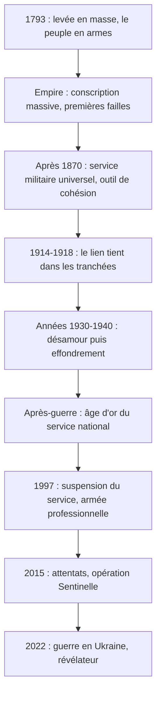

# Le lien Armée-Nation : histoire, mutations et permanence d'un principe stratégique
Retour : [[00 - Sommaire Sigem 2026]] · Précédent : [[11 - L'esprit de défense]] · Suite : [[13 - L'engagement]]

> [!abstract] Résumé
> Forgé en **1793**, le lien Armée-Nation a été glorieux, brisé, réparé, transformé. De la levée en masse à la professionnalisation, l'armée reflète la société. Distendu depuis 1997, il redevient une **nécessité stratégique** (attentats de 2015, guerre en Ukraine). Son ciment : les **forces morales**.

L'institution militaire s'est longtemps pensée — et a été perçue — comme **le reflet du pays qu'elle défend**. Ce lien affectif, historique et politique reste « l'un des **piliers silencieux** de la stratégie française ».

## Chronologie du lien

## Une relation fondatrice : de la levée en masse à la République
- **1793** : la Révolution est encerclée ; la **Convention** décrète la **levée en masse**. **Carnot** organise et **conceptualise** une armée née du peuple. « Le soldat devient citoyen ; le citoyen devient soldat » : un **basculement anthropologique**, la guerre n'est plus le fait d'une caste mais d'**un peuple en armes**.
- **Empire** : la **Grande Armée** repose sur une conscription massive ; Napoléon s'appuie sur des soldats jeunes, mal formés mais déterminés. Dès l'**Espagne (1808-1814)** et la **Russie (1812)** : lassitude, désaffection, désertions.

> [!warning] Leçon
> Une armée issue du peuple **ne garantit pas** l'adhésion inconditionnelle du peuple à ses guerres.

- **Après 1870** : la République réconcilie l'uniforme et le suffrage. Le général **Jules Lewal** (*Études de guerre*) plaide pour une **armée républicaine enracinée** dans la société. Le **service militaire universel** devient un **outil de cohésion** : on y apprend à manier les armes et à **vivre ensemble**.
- **1914-1918** : le lien tient malgré la boue et le sang, car l'armée est peuplée de **visages familiers**, l'**arrière soutient l'avant** et les soldats **savent pourquoi ils se battent**. Effort de guerre, économie dirigée, sacrifices partagés : une **Nation en armes**.

## Fractures et recompositions au XXe siècle
- **Années 1930** : France fatiguée, pacifiste, divisée ; l'armée subit le désamour.
- **1940** : elle s'effondre avec l'État — pas seulement une défaite militaire, une **crise du lien**. La **Résistance** et les **FFL** reprennent le flambeau (« clandestinité civique ») ; **de Gaulle** incarne le redressement.
- **Après-guerre** : **âge d'or du service national** (guerre froide). Il devient un **rite de passage** où l'on côtoie d'autres milieux. Le général **Ailleret**, acteur de la dissuasion, incarne une armée moderne mais connectée à la Nation.
- **1997** : **suspension du service national**. L'armée devient professionnelle : **gain d'efficacité, perte de visibilité**. Les Opex se multiplient avec un faible écho ; le citoyen voit le soldat comme un **technicien spécialisé**. Le lien est **distendu, pas rompu**.

## Un principe stratégique à réinventer
- **2015** : les **attentats de Paris** rappellent la fonction première de l'armée, **protéger**. L'**opération Sentinelle** remet le soldat dans la rue : il rassure, mais interroge. Comment retisser le lien dans une société **fragmentée, méfiante, individualiste** ?
- **Guerre en Ukraine** : une armée nationale soutenue par une **population mobilisée** tient tête à un agresseur supérieur en nombre (réserve citoyenne, résilience sociale). Le général **Pierre Schill** (CEMAT) alerte : **sans ancrage populaire, pas de défense crédible**.

> [!important] Thèse des auteurs
> Le lien Armée-Nation n'est **ni une nostalgie ni une obligation morale** : c'est une **nécessité stratégique**. Une armée efficace doit être **comprise, soutenue, incarnée** — affaire de **culture commune, de confiance et de respect mutuel**, pas seulement de budget ou de recrutement.

## Les forces morales, ciment du lien
> [!quote] Clausewitz
> « La guerre est un acte de force, mais un acte moral de bout en bout. »

- Toute stratégie repose sur des **forces matérielles** (effectifs, technologies, logistique) et des **forces morales**, plus difficiles à mesurer mais **plus décisives**.
- Forces morales = **confiance, légitimité, motivation, sentiment d'appartenance, foi dans la cause**.
- Le soldat combat mieux quand il agit pour une communauté qui le **comprend et le soutient**. Une armée **isolée** voit sa cohésion s'effriter, le courage « s'individualiser », sa résilience se fragiliser.
- Le lien moral est une **ressource stratégique**, au même titre que la supériorité technologique ou le renseignement.

À l'ère professionnelle, entretenir ces forces morales exige un **effort conscient** :

- **communication claire** des missions ;
- **reconnaissance publique** ;
- **éducation civique** et **mémoire partagée** ;
- une culture militaire **lisible, ouverte**, incarnée dans des **symboles** compris par la société.

> [!tip] À retenir
> « Dans la durée, la supériorité d'une armée dépend moins de ses armes que de la **conviction de ceux qui les portent** et du **soutien de ceux qu'ils protègent**. »

> [!question]- Exercice : pourquoi le lien a-t-il tenu pendant la Première Guerre mondiale ?
> L'armée était peuplée de visages familiers, l'arrière soutenait l'avant et les soldats savaient pourquoi ils se battaient.

> [!question]- Exercice : quels effets a eu la suspension du service national en 1997 ?
> Une armée plus efficace mais moins visible ; le citoyen s'éloigne des réalités militaires et perçoit le soldat comme un technicien : le lien se distend sans se rompre.

> [!question]- Exercice : que recouvrent les « forces morales » ?
> La confiance, la légitimité, la motivation, le sentiment d'appartenance et la foi dans la cause défendue.
