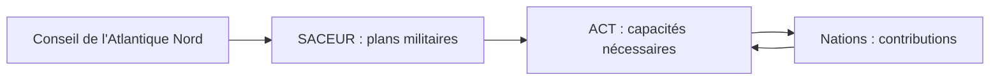

# Otan et innovation : *A Question of Time*
Retour : [[00 - Sommaire Sigem 2026]] · Précédent : [[14 - Fiabilité et crédibilité des alliances]] · Suite : [[Formulaire - À retenir Sigem 2026]]

> [!abstract] Résumé
> L'accélération géopolitique laisse l'Occident en état de **sidération**. L'Europe doit à la fois **relancer son industrie d'armement** et **transformer ses armées**. L'Otan, forte de son ADN de 1949, planifie via le **NDPP**. Mais l'innovation est désormais **civile** (la « Tech ») : il faut importer ses technologies et ses méthodes, réintroduire le **risque**, repenser les **concepts** et l'**entraînement**. Le temps pour s'adapter est **compté**.

## Le constat : une accélération brutale
- Les fondamentaux de la sécurité internationale s'effondrent **comme des dominos** (traités, mémorandums, conventions, droit des conflits). « L'impensable et l'imprévisible se sont à nouveau ligués. »
- Un **réarmement puissant** a commencé au tournant du siècle, pendant que les Européens **désarmaient et se désindustrialisaient**.

> [!important] La double problématique européenne
> 1. **Réorienter et redynamiser en urgence l'industrie d'armement**, mise en veilleuse, pour combler les lacunes béantes des armées.
> 2. **Réaliser une profonde adaptation capacitaire** aux évolutions très rapides du champ de bataille (Ukraine, Proche-Orient, course aux armements en Asie).

## L'ADN originel de l'Otan
- **1948** : **traité de Bruxelles** entre un premier noyau européen (**France, Royaume-Uni, Belgique, Pays-Bas, Luxembourg**). Ce sont les Européens, **la France en tête**, qui convainquent les États-Unis de s'engager durablement.
- L'Europe occidentale est alors menacée par une combinaison de **guerre hybride** et de **chantage militaire** : **coup de Prague** (février 1948), **blocus de Berlin** (juin 1948 – mai 1949).
- **Traité de Washington (1949)** : rédigé dans un contexte de grandes fragilités — internes (reconstruction, divisions politiques) et militaires face au « rouleau compresseur » soviétique (l'URSS avait perdu **20 millions de morts** ; aujourd'hui la Russie consentirait environ **20 000 pertes par mois**, morts et blessés). Plus d'armées, plus d'industrie : tout est à reconstruire.
- La défense collective puise sa force dans la conscience de devoir « **faire corps** » face à un ennemi plus puissant que chaque allié.

> [!tip] À retenir
> L'ADN de l'Otan : **pragmatisme militaire** + **conscience politique d'une unité de destin** des démocraties européennes.

Cet ADN parle aux nouveaux membres (**Suède**, **Finlande**) pour qui la guerre en Ukraine a mis fin à l'équilibre prudent de la guerre froide. L'Otan leur apporte :

- la **profondeur stratégique** dont ils manquent géographiquement ;
- de l'**épaisseur militaire** ;
- un **creuset de savoir-faire unique au monde** : à la guerre, tout n'est pas matériel — volonté, unité, stratégie, maîtrise opérative et tactique, **concepts** pertinents.

## La planification de défense : le processus Otan
1. Le **Conseil de l'Atlantique Nord** demande au **SACEUR** (Commandant suprême des forces alliées en Europe, le général américain **Christopher Cavoli**) de mettre à jour **en un temps record** les plans militaires face à une Russie « **hors les murs** », qui agit physiquement et immatériellement dans toute la zone de l'Otan.
2. **ACT** (*Allied Command Transformation*) définit les **capacités** nécessaires pour obtenir les effets de ces plans.
3. ACT **répartit les contributions** entre les nations.

Ce processus itératif est le **NDPP** (*NATO Defence Planning Process*), sorte de « **loi de programmation militaire de l'Alliance** », sur **deux décennies**, intimement lié au réarmement de chaque nation.

### Un double enjeu capacitaire
- **Le « ré-épaississement »** : redonner **épaisseur et résilience** à des armées taillées pour la guerre **expéditionnaire limitée**, pas pour un **conflit symétrique** de grande ampleur. Les plans du SACEUR doivent être réalisables **dès maintenant** (« ***fight tonight*** ») → effort industriel massif et durable.
- **La transformation** : reprendre l'**ascendant conventionnel** nécessaire à la stratégie « **Défendre et Dissuader** ». La guerre en Ukraine est un **lieu d'apprentissage** tactique et technique : il faut adapter matériels, concepts, doctrines et entraînements à ce rythme, nationalement **et** collectivement.

## La question de l'innovation
Pendant la guerre froide, la recherche majeure était **militaire** ; après 1989, l'investissement de défense a fortement ralenti. Aujourd'hui, le développement technologique est **majoritairement civil**.

| Acteurs | R&D annuelle |
|---|---|
| 10 premières entreprises de la « Tech » américaine | **180 Md\$** |
| 10 premières entreprises de défense américaines | 50 Md\$ |
| 10 premières industries de défense européennes | **10 Md\$** |

Il faut donc **importer les technologies civiles** : IA, conception numérique, *cloud*, *New Space*, biomédical…

### Deux mondes que tout oppose

| Monde militaire actuel | Monde de la « Tech » civile |
|---|---|
| La **spécification** règne | Accepte un **taux de rebut** élevé |
| Cycles de développement calibrés, règles financières et contractuelles fortes | Privilégie le produit vendable tout de suite (***Minimum Viable Product***) et l'**incrémental** |
| Produit « parfait » | « **Tue** » sans regret les idées qui échouent |
| Besoin défini par les états-majors, Retex bureaucratisé | Développement **au contact direct du client**, peu d'intermédiaires |
| Programmes en **années, voire décennies** | Cycles en **mois** ; culture de la **disruption** |

### Ce que la Tech apporte… et ce qu'elle n'apporte pas
**Apports** : décider **mieux et plus vite** (agrégation et traitement des données) ; des effets mieux ciblés avec des chaînes d'effecteurs bien dimensionnées ; un **ciblage** plus efficace ; une **logistique** plus parcimonieuse ; des armes capables de s'adapter en continu aux parades ennemies.

> [!example] Le problème du coût
> Le rapport entre le coût d'un missile antiaérien **Patriot / Aster** et celui d'un **drone** abattu est d'environ **100**.

> [!warning] Pas de « *magic bullet* »
> La Tech ne remplacera pas les **capacités physiques** de la guerre. Jack **Watling** (RUSI, *The Arms of the Future*) : « voir la technologie comme un moyen de rendre la guerre moins chère, les armées plus petites et le combat moins viscéral et tragique, est **naïf et dangereux**. La guerre continuera d'exiger des efforts humains à grande échelle et de générer d'énormes souffrances. »

## Une révolution copernicienne pour les administrations militaires
Après trente ans de programmes contraints, régulés par l'**étalement calendaire** et la **réduction des cibles**, le passage au monde de l'innovation civile est un **choc culturel** :

- **Réintroduire le risque** à chaque étape : risque contractuel, juridique, technique (ne pas aboutir là où c'était prévu) — comme les pionniers de la reconstruction industrielle d'après-guerre.
- **Inventer de nouvelles méthodes de conception** : le rôle des états-majors change. Les solutions civiles, centrées sur l'utilisateur et « désintermédiées », posent un problème de **cohérence** et d'**interopérabilité**. Trouver l'équilibre entre le « **besoin terrain** » (que la Tech capte mieux que le Retex) et un ensemble **interopérable** au niveau **opératif et interarmées**.
- **Le domaine des concepts** : modélisation, simulation, **jeux de guerre** pour définir comment commander avec ces moyens. ACT travaille sur un concept d'**opérations multi-domaines** (comprendre les couplages entre milieux physiques et immatériels).
- **L'entraînement** : il ne s'agit plus seulement de qualifier des troupes pour des concepts établis, mais de développer la **créativité** et la capacité à s'adapter à un ennemi qui **apprend tous les jours**.

> [!info] Rien de neuf sous le soleil
> Après 1918, l'**Allemagne**, aux forces réduites par le **traité de Versailles** mais dotée d'une grande **vigueur intellectuelle**, a conçu et expérimenté l'emploi coordonné du **char et de l'avion**.

## Conclusion : *a question of time*
La vitesse du désordre et du déploiement des technologies (notamment en **Asie**) défie des organisations façonnées par la **stabilité** et par le concept de **crise**, par essence limitée dans le temps.

> [!tip] À retenir
> Les armées occidentales doivent **se réinventer au rythme d'un monde qui ne les attendra pas** : ré-épaissir **et** transformer, en important la culture de l'innovation civile.

> [!question]- Exercice : qu'est-ce que le NDPP ?
> Le *NATO Defence Planning Process* : processus capacitaire itératif de l'Otan sur deux décennies ; ACT y définit les capacités nécessaires aux plans du SACEUR et répartit les contributions entre les nations.

> [!question]- Exercice : quel est le double enjeu capacitaire de l'Alliance ?
> Le ré-épaississement des armées (épaisseur, résilience, « fight tonight ») et leur transformation pour reprendre l'ascendant conventionnel au service de « Défendre et Dissuader ».

> [!question]- Exercice : quels événements de 1948-1949 ont conduit à la création de l'Otan ?
> Le coup de Prague (février 1948) et le blocus de Berlin (juin 1948 – mai 1949), après le traité de Bruxelles de 1948.
