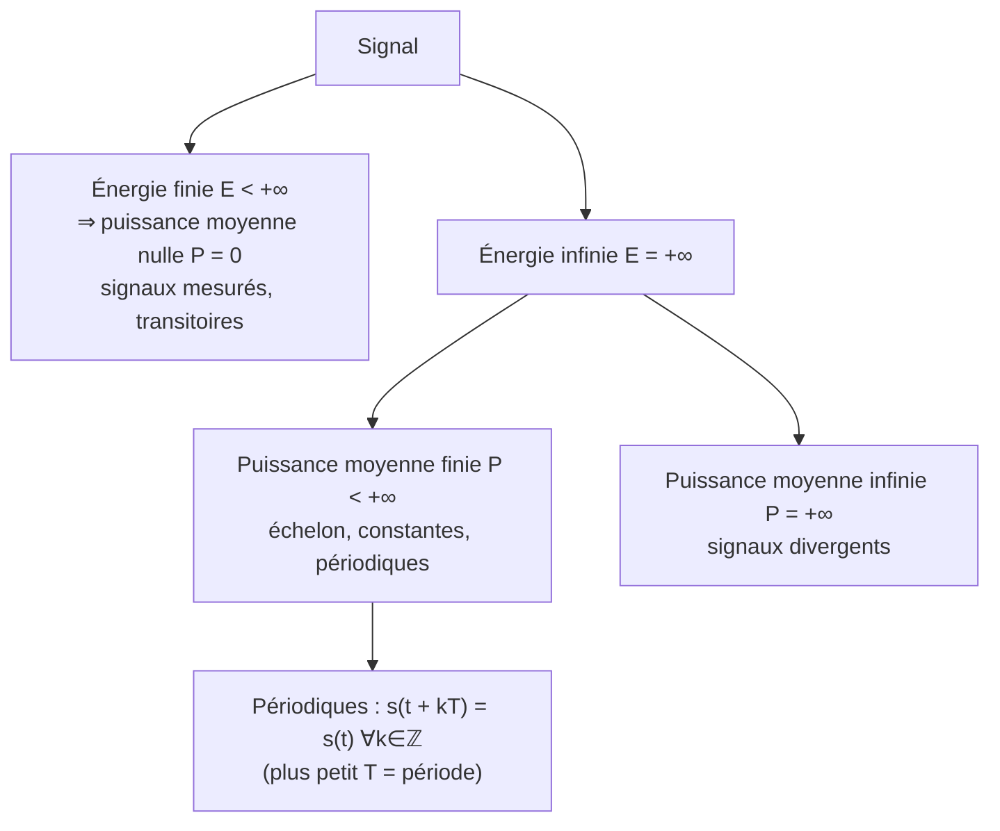

# Classes de signaux (rappel)
Retour : [[00 - Sommaire TSN]] · Précédent : [[02 - Bruit et modèle d'observation]] · Suite : [[04 - Transformée de Fourier à temps continu]]

> [!tip] Pourquoi classer ?
> **Les méthodes d'analyse dépendent de la classe du signal étudié** (TF pour l'énergie finie, série de Fourier pour les périodiques, DSP pour les aléatoires…).

## 1. Déterministe vs aléatoire
> [!note] Déterministe
> Reproductible / prédictible **exactement** si l'on connaît exactement les conditions initiales. Ex. : $s[n] = \alpha_2 n^2 + \alpha_1 n + \alpha_0$.
>
> **Chaos déterministe** : si une faible erreur de modèle mène à un comportement très différent → non prédictible en pratique → on utilise un **modèle aléatoire**.

> [!note] Aléatoire
> Irreproductible / imprédictible exactement même avec une connaissance exacte des conditions initiales. Il n'existe pas (dans la nature) d'équation physique générant exactement le signal.

## 2. Continu vs discret
| Continu : $s(t),\ t\in\mathbb{R}$ | Discret : $s[n],\ n\in\mathbb{Z}$ |
|---|---|
| Ondes électromagnétiques, sonores | Signal continu échantillonné par un capteur |
| Signaux analogiques | Processus discrets, séries chronologiques |

> [!question] Exercice du cours — à quelles classes appartiennent ces signaux ?
> Impulsion EM radar ; mesure radar numérique ; signal en sortie d'un câble jack ; signal en entrée d'un microphone dans une chambre anéchoïque ; vidéo sur film argentique ; vidéo numérique.

> [!success]- Proposition de réponse
> | Signal | Temps | Nature | Dim. | Énergie/puissance |
> |---|---|---|---|---|
> | Impulsion EM radar | continu | déterministe (forme d'onde connue) | 1D | énergie finie |
> | Mesure radar numérique | discret, quantifié | aléatoire (bruit, cible inconnue) | 1D à multi-D (impulsions × distance × antennes) | énergie finie (support fini) |
> | Sortie d'un câble jack | continu (analogique) | aléatoire (contenu audio + bruit) | 1D (2D si stéréo) | puissance finie |
> | Entrée micro en chambre anéchoïque | continu | aléatoire (bruit résiduel), quasi déterministe si source contrôlée | 1D | puissance finie |
> | Vidéo sur film argentique | **discrète en temps** (images/s), **continue en espace** | aléatoire | multi-D | énergie finie |
> | Vidéo numérique | discrète en temps **et** en espace, quantifiée | aléatoire | multi-D (x, y, t, couleur) | énergie finie |
>
> Le point clé : un film argentique est déjà échantillonné en temps mais pas en espace.

## 3. Dimension : 1D vs multi-D
- **1D** : $s[n] = e^{2i\pi f_0 n/T} \in \mathbb{C}$
- **multi-D** : $s[n,p,q] = e^{2i\pi \mathbf{r}_q^T\mathbf{u}_p/\lambda}\, e^{2i\pi f_0 n/T} \in \mathbb{C}$, soit $s[n] \in \mathcal{M}_{P,Q}(\mathbb{C})$ (ex. réseau d'antennes).

Si les dimensions sont de même nature / ont une relation spatiale → **image** ou **vidéo**.

## 4. Énergie et puissance

### Signaux continus
$$
E = \int_{\mathbb{R}} |s(t)|^2\,dt \ \ (\text{J}) \qquad\qquad P = \lim_{T\to\infty} \frac{1}{2T}\int_{-T}^{T} |s(t)|^2\,dt \ \ (\text{W})
$$

### Signaux discrets
$$
E = \sum_{n\in\mathbb{Z}} |s[n]|^2 \qquad\qquad P = \lim_{N\to\infty} \frac{1}{2N+1}\sum_{n=-N}^{N} |s[n]|^2
$$

### Classification

> [!question] Exercice du cours (continu) — calculer $E$ et $P$
> $a(t) = \Pi_{[-T;T]}(t)$, $b(t) = t$, $c(t) = \Pi_{\mathbb{R}^+}(t)e^{-3t}$, $d(t) = \cos(2\pi t)$, $e(t) = e^{2i\pi t}$, $f(t) = \Pi_{[-T;T]}(t)\cos(2\pi t)$.

> [!success]- Correction
> | Signal | $E$ | $P$ | Classe |
> |---|---|---|---|
> | $a(t)$ porte | $2T$ | $0$ | énergie finie |
> | $b(t)=t$ | $+\infty$ | $+\infty$ | divergent |
> | $c(t)=\Pi_{\mathbb{R}^+}e^{-3t}$ | $\int_0^\infty e^{-6t}dt = \tfrac16$ | $0$ | énergie finie |
> | $d(t)=\cos(2\pi t)$ | $+\infty$ | $\tfrac12$ | périodique (période 1) |
> | $e(t)=e^{2i\pi t}$ | $+\infty$ | $1$ (car $\lvert e(t)\rvert=1$) | périodique |
> | $f(t)$ cos fenêtré | $T + \frac{\sin(4\pi T)}{4\pi}$ | $0$ | énergie finie |
>
> Pour $f$ : $\int_{-T}^{T}\cos^2(2\pi t)\,dt = \int_{-T}^{T}\frac{1+\cos(4\pi t)}{2}dt = T + \frac{\sin(4\pi T)}{4\pi}$.

> [!warning] Coquille dans les slides
> Les slides écrivent $\cos(2i\pi t)$ : il faut lire $\cos(2\pi t)$. (Au pied de la lettre, $\cos(2i\pi t) = \cosh(2\pi t)$, signal divergent.)

> [!question] Exercice du cours (discret) — mêmes signaux avec $n\in\mathbb{Z}$
> $a[n]=\Pi_{[-T;T]}[n]$, $b[n]=n$, $c[n]=\Pi_{\mathbb{R}^+}[n]e^{-3n}$, $d[n]=\cos(2\pi n)$, $e[n]=e^{2i\pi n}$, $f[n]=\Pi_{[-T;T]}[n]\cos(2\pi n)$.

> [!success]- Correction
> | Signal | $E$ | $P$ |
> |---|---|---|
> | $a[n]$ ($T$ entier) | $2T+1$ | $0$ |
> | $b[n]=n$ | $+\infty$ | $+\infty$ |
> | $c[n]$ | $\sum_{n\ge0} e^{-6n} = \frac{1}{1-e^{-6}}$ | $0$ |
> | $d[n]=\cos(2\pi n)$ | $+\infty$ | $1$ |
> | $e[n]=e^{2i\pi n}$ | $+\infty$ | $1$ |
> | $f[n]$ | $2T+1$ | $0$ |
>
> **Piège intéressant** : pour $n$ entier, $\cos(2\pi n) = 1$ et $e^{2i\pi n}=1$ ! Échantillonner une sinusoïde de fréquence 1 avec une période 1 donne une **constante** : c'est un cas extrême de [[07 - Échantillonnage et théorème de Shannon-Nyquist|repliement spectral]]. D'où $P=1$ et non $\tfrac12$ pour $d[n]$.

## Résumé
- Déterministe **ou** aléatoire
- Continu **ou** discret
- 1D **ou** multi-D
- Énergie finie, puissance finie, périodique
