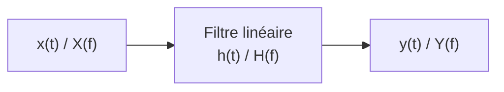

# Filtrage linéaire
Retour : [[00 - Sommaire TSN]] · Précédent : [[12 - Estimation de la densité spectrale de puissance]] · Révision : [[Formulaire - À retenir]]

## Rappel : système linéaire invariant dans le temps (SLIT)
> [!note] Filtre
> Système physique qui **modifie un signal** en laissant passer certaines fréquences et en atténuant, voire supprimant, d'autres.

> [!note] Linéarité
> $x(t) + \lambda y(t) \longrightarrow \tilde x(t) + \lambda\tilde y(t)$ (la sortie d'une combinaison linéaire est la combinaison des sorties).
> **Invariance** : un retard en entrée donne le même retard en sortie.

| Domaine | Relation | Caractérisation |
|---|---|---|
| Temporel | $y(t) = (h*x)(t)$ | $h(t)$ : **réponse impulsionnelle** |
| Fréquentiel | $Y(f) = H(f)\,X(f)$ | $H(f)$ : **fonction de transfert** |
| Aléatoire (DSP) | $S_y(f) = \lvert H(f)\rvert^2 S_x(f)$ | gain en puissance $\lvert H\rvert^2$ |

> [!info] Complément : version discrète (suite du module)
> - Convolution discrète : $y[n] = \sum_{m} h[m]\,x[n-m]$
> - En fréquence : $Y[k] = H[k]X[k]$ **si** on évite l'effet circulaire par zéro-padding ([[09 - Transformée de Fourier discrète#Convolution circulaire]]).
> - **RIF** (réponse impulsionnelle finie) : $y[n] = \sum_{m=0}^{L-1} b_m x[n-m]$ ; **RII** (infinie, récursif) : $y[n] = \sum b_m x[n-m] - \sum_{m\ge1} a_m y[n-m]$.
> - MATLAB : `y = filter(b, a, x)`, `conv(x,h)`, réponse en fréquence `freqz(b, a, nfft, Fe)`.
> - Exemples déjà rencontrés : le **filtre anti-repliement** ([[07 - Échantillonnage et théorème de Shannon-Nyquist]]) et le **fenêtrage**, qui est un produit (et non un filtrage).
